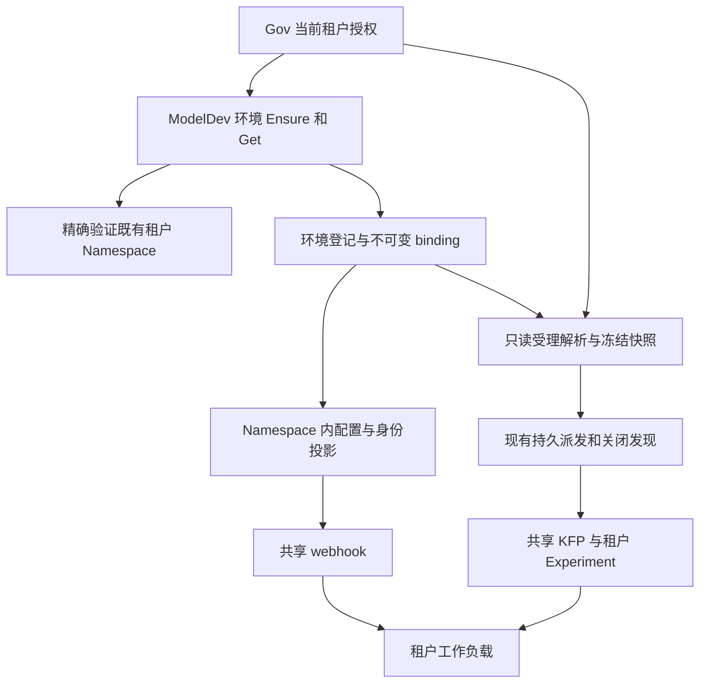

# ModelDev 动态租户执行环境开通与调度接入实施方案

版本：1.0  
日期：2026-11-01（Asia/Shanghai）  
实施对象：ani-modeldev-service、ani-governance、ani-resource-service，以及指定测试集群内的 ModelDev 接入资源。  
任务目录：`.scratch/modeldev-dynamic-tenant-environment/`。  
状态：设计已收敛，供实施使用；环境验收结果由执行 agent 填写，不能将本方案当成验收通过证明。

## 0. 实施目标与已经确定的选择

一个共享 ModelDev 服务实例能够按可信租户身份，接入已经存在的标准租户 Namespace。租户显式开通环境后，无需重启 ModelDev 或 webhook，即可提交训练和微调；执行的派发、回调、停止、关闭、资源清理、产物查询和 GPU 原占额释放覆盖全部接入租户。

本方案中的“开通”只指 ModelDev 执行能力接入，不包含租户创建或 Namespace 初始化。

| 决策 | 本期固定做法 |
|---|---|
| 服务部署 | 一个共享 ModelDev 部署服务多个租户；不按租户复制服务 |
| Namespace | 复用 `tenant-<resource_tenant_id>`；各 owner 独立精确 GET |
| Namespace 缺失 | 明确报错；不创建、不补标签、不按旧名字回退 |
| 环境入口 | Gov 当前租户下的显式 Ensure/Get；业务提交不隐式开通 |
| KFP 控制身份 | 沿用 `ani-system/modeldev-control` 的 projected token |
| 固定 Pipeline | 在已有 `ani-system` Namespace 统一发布受管定义；每租户独立 Experiment |
| 开通持久化 | 一张环境登记表；同 tenant + cluster 唯一；无后台开通调度器 |
| webhook 的环境来源 | 环境登记生成固定名字的 Namespace 内 ConfigMap 投影；不接入 ModelDev 业务数据库 |
| 正常派发 | 修改发现范围；保留现有 Reserve、关闭 fence 和不确定发送规则 |
| 旧实现 | 先排空并清除本次范围内旧 ModelDev 记录和资源，再切新实现；不导入旧 binding，不保留兼容分支 |
| 当前集群范围 | 一份部署配置只管理一个明确 cluster_id 和 KFP 连接；不实现跨集群选址 |
| 前端及初始化 | 新增必要 API 和权限登记；不做新页面、菜单、完整租户初始化或套餐模块 |
| 其他服务 | 不改 Inference、ACC 调度算法、Model 模型协议或 installer 链路 |

不得将一个启动 binding 改成配置文件中的 binding 数组后宣布完成。不得新增另一套任务队列、租户调度器、执行 lease、用户 token 发行服务或环境版本兼容系统。

## 1. 代码与环境基线

### 1.1 本轮复核的 main

以下 SHA 于本方案编制时再次从远端 main 获取，与核验材料一致。实施开始时重新读取 main；若有变化，只复核相关差异并更新实施记录，不能把旧 SHA 描述为届时最新 main。

| 仓库 | 精确 SHA |
|---|---|
| `zhangzhe-ctrl/ani-modeldev-service` | `21bf4bd6540d462a61c91b629f26250899583223` |
| `zhangzhe-ctrl/ani-governance` | `ddd98f4c79751ba848fa862bab6878dc7bc99bb7` |
| `zhangzhe-ctrl/ani-resource-service` | `23e25b33ca02890231cd273ef7246b0fc415476c` |

ModelDev main 已包含 ServiceAccount 镜像凭据继承修复和“未形成 runtime 事实也能按既有条件释放 GPU 占额”的修复。本任务不得将这两项行为回退。[S1]

代码 main 与现场镜像之间尚无完整可信构建映射。实施交付必须提供最终提交、构建产物 digest、部署 imageID 的对应关系。

### 1.2 指定环境

| 项目 | 已核实值 |
|---|---|
| SSH 入口 | `kubercloud@100.64.128.12` |
| kubectl context | `kubernetes-admin@ani-kcn-full` |
| Kubernetes API | `https://lb.kubesphere.local:6443` |
| 平台 cluster_id | `f39bf6e2-f3ed-4191-ada3-caeebf86c220` |
| kube-system UID | `3eeb5379-8748-4bf8-8f6d-d7a48ce3bc24` |
| Kubernetes | `v1.35.8` |
| KFP | `2.16.0`；multi-user=true；shared-read=false |
| KFP 入口 | `https://ani-kfp-entry.kubeflow.svc:8443` |
| KFP audience | `pipelines.kubeflow.org` |
| KFP Pipeline namespace 要求 | `REQUIRE_NAMESPACE_FOR_PIPELINES=true` |

实施先检查入口、context、API、cluster_id 和 kube-system UID。任何一项不一致，停止该环境的写操作，先定位差异；不能仅因 SSH IP 相同就认定目标正确。

| 样本 | Gov ID | resource_tenant_id | 标准 Namespace UID |
|---|---:|---|---|
| A | 2 | `64c5c35a-f554-432c-b4bc-7b4f36f08420` | `a8d8a472-8a8a-43cf-abf0-0e805bbe67b0` |
| B | 40 | `207328fc-f08d-4dc4-b403-16ec86396ce2` | `8698b0b5-f4c8-4770-85e5-10f25ad7b347` |

A/B 标准 Namespace 已存在且归属正确。旧环境 `ani-modeldev-tenant-a-v21` 与 A 的标准 Namespace 是不同对象。A 标准 Namespace 还承载 VM、Sandbox 和其他 PVC，禁止整 Namespace 清空。[E1]、[E2]、[E3]

### 1.3 开工前只补齐这些输入

不再重复全量核验。下列项是具体部署材料，必须写入 `deployment-inputs.json` 并提供证据后再启用开通；不能临时猜值。

| 输入 | 如何取得 | 固定处理规则 |
|---|---|---|
| 真实 KFP 控制 token 正向调用 | 使用服务内部已有受管身份路径或本次实现的测试入口；不输出 token | 证实 principal/audience；失败则修复同一 SA/Bearer 路径，不临时改 OIDC 或租户 token 系统 |
| 固定定义的发布结果 | 重新发布四个受管定义后精确 GET | 记录 Pipeline/Version ID、父 namespace、IR digest；全部使用 `ani-system` |
| KFP Experiment 唯一性 | 核实实际 `experiments` 表的 name+namespace 唯一约束，或对自有测试 Experiment 验证同名冲突 | 未证实唯一性时，未知创建结果只查证，不自动再 POST |
| KFP runner 的 Namespace 配置 | 精确读取公开 endpoint、region、metadata host/port、CABUNDLE_KEY_NAME、driver/launcher TLS flags | 使用第 10 节固定 S3 SecretRef 模式和对象名字；不猜公开部署值，不复制业务存储凭据 |
| KFP 专用 artifact 凭据及权限 | 现有对象存储 owner 提供仅限独立 artifact bucket 的平台身份；只记录挂载文件引用及权限验证结果 | 由 Ensure 写固定的 KFP Secret；普通租户不能直接读取或借 Pod 挂载它。不能将共享 AK 描述为租户级 S3 IAM 隔离 |
| 原生 ModelDev policy | 精确 GET 当前 policy/binding 及其 UID、selector、参数引用 | 只替换 ModelDev 自有策略；共享 `ani-kfp-trainjob` 保持其 owner 边界 |
| ModelDev 步骤配置与公开 CA | 已部署配置和受管证书材料 | 使用本方案固定 CM 名；内容由平台模板生成，租户/UID 来自 live Namespace |
| 实际 controller principal | Deployment/Pod SA 与 Admission 事实 | 固定 Argo、Trainer、JobSet、Job controller、KFP API Server 的 principal；不能根据名字猜 |
| 镜像、桶、连接、workspace 配置 | 现有受管配置及实际资源 | 连接/bucket/CA 为平台配置；租户前缀由本方案算法产生 |
| API server授权模式与平台可信主体 | 实际启动/结构化授权配置、现有平台身份与管理责任 | 本期要求已核实Node+RBAC；采用第11.4节动态授权边扫描，不猜普通租户凭据或扩大可信组 |
| Argo WorkflowDefaults | 精确读取当前controller ConfigMap | 当前证据无WorkflowDefaults；新配置如引入模板/参数改写先按固定IR核实，不能任意放开Workflow模板 |
| 旧数据与资源清理清单 | ModelDev/Gov 只读查询和精确 K8s/KFP 对象读取 | 记录 tenant/execution/operation/原 UID、占额和释放状态；按第 13 节执行 |

这些输入可以阻止环境被标记 READY，不重新开放第 0 节已经决定的架构选项。

## 2. 系统统一的租户 Namespace 合同

### 2.1 名称、身份与标签

`resource_tenant_id` 必须是完整、规范、小写、非零 UUID。拒绝大写、空白、无连字符形式、零 UUID、Gov 数字租户 ID、租户 code。不得在 owner 内通过自动 lowercase 或截断接受不规范输入。

```text
namespace_name = "tenant-" + resource_tenant_id
namespace_identity = (cluster_id, namespace_name, namespace_uid)
```

完整名称长 43 个字符。不加 ModelDev 后缀，不使用 hash、短 UUID、可配置租户前缀或 fallback。

权威 Namespace 标签为：

```yaml
network.ani.io/tenant-id: <resource_tenant_id>
network.ani.io/managed-by: ani-network-service
```

上述标签只描述 Namespace 归属。Pod 的 `ani.io/tenant-id` 监控标签、ModelDev 工作负载注解和 Res Secret 自身的 writer 标签不随之全局替换。

### 2.2 所有参与 owner 的查询顺序

1. 从可信入站上下文取得 resource UUID；从 owner 已配置的受管连接取得 cluster_id。
2. 严格验证 UUID，按唯一算法推导 Namespace 名。
3. 在该 cluster 的 Kubernetes client 上精确 GET 这个名字；不得 LIST 后取第一个匹配，也不得按 label 搜索后接受其他名字。
4. 校验 name、两项权威 label、UID 非空、`phase=Active`、`deletionTimestamp=nil`。
5. 已有绑定或执行快照时，再比较原 Namespace UID；同名重建不视为原对象。
6. 返回结构化身份；缺失、错属、终止中、UID 变化、权限不足、连接不可用分别返回明确诊断。
7. 在身份验证成功前，不创建 SA、RBAC、Secret、Experiment、PVC、训练资源或业务命令。

业务 owner 不 CREATE/PATCH/DELETE Namespace，也不修补其标签。未来完整租户初始化流程负责提供符合本合同的 Namespace；本任务只定义和消费这个前置条件。

Active/无删除时间是开通、新受理和新创建的前提。原执行的只读证据、Stop、close、cleanup 不因原 Namespace 正在 Terminating 就改用新对象或要求重新开通；验证原 name/归属/UID 后沿既有关闭证据规则处理。原对象消失或 UID 变化时拒绝对替代对象写入；单次404仍不能代替完整 writer/释放证明。

### 2.3 对 Gov、Res 和 ComputeSelection 的约束

Gov 继续通过已认证 Principal、当前授权和 `sys_tenants.resource_tenant_id` 建立可信租户上下文。浏览器的 tenant/namespace/cluster 字段不能直接成为出站资源身份。

本期 ModelDev 仅使用部署配置中的一个 cluster。CPU ComputeSelection 当前没有顶层 cluster_id，不给 Gov 增加臆造集群的责任；GPU Selection 中已有 cluster_id 必须等于 ModelDev 配置集群，否则拒绝为 `COMPUTE_CLUSTER_MISMATCH`。不能静默改用其他集群或重新选择预设。

各 owner 可在自己的边界内实现相同的小型解析器。通过包内 `contracts/tenant-namespace-vectors.json` 统一测试向量；不新建跨服务通用运行时库或 Res Namespace RPC。

## 3. 目标结构与权威数据



### 3.1 平台配置与租户配置分离

平台配置只保存一次：cluster_id、KFP connection/endpoint/CA/token 文件、共享控制 principal、固定 catalogue、公开 CA、步骤 callback endpoint、controller principal、受管 registry、物理对象存储连接及 bucket、workspace/时限/OCI platform。

租户环境登记保存：可信 tenant UUID、推导 Namespace 名、原 UID、该环境固定身份、Experiment、受管镜像 Secret 引用、租户 storage scopes、允许的材料摘要和发布完成事实。

环境对象中不保存 token、密码、Secret data、DSN、临时 STS 会话、客户端 kubeconfig；平台配置不得再含单个租户 UUID、单 tenant binding 文件或按租户展开的 facts/STS 白名单。

### 3.2 一张环境登记表

新增 `modeldev_tenant_execution_environments`。下表是逻辑字段合同；允许按仓库 sqlc 风格调整 SQL 类型别名，不允许改变主键、唯一性或可变性。

| 字段 | 类型与约束 | 用途 |
|---|---|---|
| environment_id | UUID，主键，服务端首次生成，永不换号重试 | 与 Snapshot.Environment.BindingID 使用同一 UUID |
| tenant_id | UUID，非零 | 即 resource_tenant_id |
| cluster_id | UUID，非零 | 配置中的受管集群 |
| namespace_name | text，必须等于 tenant-UUID | 推导值，不接受用户输入 |
| namespace_uid | UUID，可在第一次 GET 前为空；取得后不可替换 | 锁定实际 Namespace |
| state | PROVISIONING / READY / BLOCKED / NEEDS_REVIEW | 当前登记状态；无行时 Get 返回 404，不合成登记 |
| phase | 有限开通步骤枚举 | 恢复位置；不是通用工作流定义 |
| provision_spec_canonical / provision_spec_hash | bytea / char(64)，首次登记时固定 | 平台批准的开通目标，不含秘密值；后续调用目标不同时报告配置漂移 |
| binding_canonical | bytea，可在发布前为空 | 严格类型的完整环境材料规范编码 |
| binding_digest | char(64)，发布时计算 | 绑定上述规范字节，不包含可变状态/时间 |
| kfp_connection_ref | text，来自平台受管配置 | 不能是用户任意 URL |
| experiment_name | text，等于 md-env-<environment_id> | 首次登记固定，重试不改名 |
| experiment_id | UUID，可在确认前为空 | KFP 返回的实际 ID，不能生成假的 KFP ID |
| experiment_create_intent | 有限 typed JSON，可为空 | 原 namespace/name/description/body digest 与发送/查证状态 |
| resource_receipts | 有限 typed JSON | 固定 SA/RB/CM、专用 Secret、镜像 Secret 引用、KFP 材料的原身份、非敏感 spec digest、确认状态和检查时间 |
| first_operation_id | UUID | 首次 Ensure 审计关联；不创建业务 Execution |
| last_operation_id | UUID | 最近一次合法 Ensure 审计关联 |
| first_actor_id / last_actor_id | 沿用可信 ActorID 的类型 | 审计关联，不能代替每次重新授权 |
| reason_code / reason_stage | 有限枚举或空 | 无凭据的诊断，READY 时为空 |
| row_version | bigint，递增 | 持久化与最终 READY 的 CAS |
| created_at / updated_at / last_verified_at / ready_at | timestamptz | 时间事实；不作为授权凭据 |

必须有 `UNIQUE(tenant_id, cluster_id)`；非空 Namespace UID 增加同 cluster 内唯一约束；非空 Experiment ID 增加 `(kfp_connection_ref, experiment_id)` 唯一约束。数据库校验名称与 tenant 相符。绑定发布后，namespace UID、Experiment、身份、连接、scope、owner 配置和已发布 binding 字节不可原地修改；用 UPDATE 条件或数据库约束落实，不能只写注释。第 10 节专用 artifact Secret 的秘密值轮换不属于 binding 材料变更。

`resource_receipts` 只允许本方案的有限对象种类，不存任意 API request、可执行脚本或可配置 step DAG。已记录对象 UID 后，同名不同 UID 是冲突，不自动收养。

Get 无行不触发 INSERT。Ensure 可以先 INSERT ON CONFLICT 建立自然唯一登记；此阶段不得产生外部副作用。原 Namespace 尚未验证时，登记只能为 PROVISIONING、BLOCKED 或 NEEDS_REVIEW，不能持有可用 binding。

### 3.3 并发与恢复

使用专用 PostgreSQL 连接上的 `pg_try_advisory_lock`。锁键固定为 `SHA256("ani.modeldev.tenant-environment.v1\\0" + tenant_uuid + "\\0" + cluster_uuid)` 前 8 字节按大端有符号 int64 解码；这里的 `\\0` 表示单个 NUL 字节。锁只串行化同一环境 Ensure，不成为执行调度许可。哈希碰撞最多导致无副作用的暂时忙，不能混用不同环境的行。

取得锁后重新读行；每个步骤采用短 SQL 事务提交意图/回执，网络调用不置于 SQL 事务中。Ensure 的本地推进预算固定 25 秒；Gov RPC 预算 28 秒，HTTP 预算 30 秒，均取调用方剩余预算与该上限的较小值。单上游调用上限 5 秒。

退出时使用独立、最多 2 秒的清理 context 在同一专用连接显式释放 advisory lock；连接断开或解锁状态不可信时丢弃连接，不能带锁放回池。没有后台开通 worker、持久 lease 或心跳。进程崩溃后靠下一次同租户 Ensure 恢复；Get 不推进开通。

锁忙、预算不足或可恢复上游错误时保留同一 environment_id 和原意图。响应明确 `retryable` 和有限重试建议；调用方重发 Ensure，不通过不断 GET 期待后台自动完成。每次重试重新验证当前授权。

### 3.4 只读投影

在目标 Namespace 发布固定 ConfigMap `modeldev-execution-environment`，data 恰为 `binding.json` 与 `binding.sha256`。内容为环境 binding 的非敏感投影，包含 tenant/cluster/Namespace UID、environment_id、SA 名称与 UID、允许 profile/material digest、managed image 引用和固定 controller 身份。`binding.sha256` 是 `binding.json` 规范字节的 SHA256 小写 hex；两键总内容上限 64 KiB。规范字节不包含 binding_digest 自身、此投影 CM 自身 UID/resourceVersion/data digest、进度和时间字段，避免自引用。投影发布回执单独存入 resource_receipts；Secret 秘密值及其摘要均不得进入规范字节。

ModelDev 数据库是权威，ConfigMap 是单向发布结果。webhook 只 GET 此投影和 live Kubernetes 对象，不写登记，不调用 Gov，不读 ModelDev 业务库。

发布顺序为：完整规范材料在数据库固定 → 创建/核对投影 → 精确回读核对 UID、字节摘要及字段 → 环境 READY。中途失败保留原绑定恢复；不将两个独立手写配置当作同一环境。

webhook 对每次匹配请求读当前投影，不使用启动期租户 map 或负缓存。公共固定软件材料仍由同一份不可变 catalogue artifact 提供；环境增加不要求部署新的软件材料或重启服务。


## 4. Gov 入口与 ModelDev 环境 RPC

### 4.1 唯一新增入口

| 项目 | Ensure | Get |
|---|---|---|
| Gov HTTP | POST /api/v1/modeldev/environment:ensure | GET /api/v1/modeldev/environment |
| 请求体 | 严格空 JSON 对象 {} | 无 body |
| Query | 禁止 | 禁止 |
| 幂等关联 | 恰好一个 Idempotency-Key，规范非零 UUID | 无 |
| 权限码 | modeldev:manage_environment | modeldev:view_environment |
| 当前角色范围 | 本租户当前有效角色、ALL 数据范围、该动作允许权限及精确 API grant | 同左，使用 view 权限 |
| 默认授权 | 租户管理员角色模板和对应当前租户管理员角色 | 管理员及明确获授此只读权限的角色 |
| ModelDev 方法 | EnsureTenantExecutionEnvironment | GetTenantExecutionEnvironment |

平台 tenant_id=0 不通过本期接口指定其他租户。没有任意目标 tenant 参数，不增加平台租户初始化路由。普通用户不能因为知道 environment_id 就查询别的环境。

Gov 复用现有 Principal、当前数据库授权、ResourceTenantID 和精确 API 权限检查。新增权限码必须登记 Permission、API 及其关联，不能只同步 API 目录而漏掉授权。前端菜单和页面不在本期范围。

### 4.2 内部 gRPC 合同

在 ModelDev 的 api/ani/modeldev/v1/tenant_environment.proto 新增：

~~~proto
service ModelDevTenantEnvironmentService {
  rpc EnsureTenantExecutionEnvironment(EnsureTenantExecutionEnvironmentRequest)
      returns (EnsureTenantExecutionEnvironmentResponse);
  rpc GetTenantExecutionEnvironment(GetTenantExecutionEnvironmentRequest)
      returns (GetTenantExecutionEnvironmentResponse);
}
message EnsureTenantExecutionEnvironmentRequest {
  string operation_id = 1;
}
message GetTenantExecutionEnvironmentRequest {}
~~~

两个 response 各自含一个 environment 字段，类型为 TenantExecutionEnvironmentView。两 request、两 response、nested view/ErrorDetail/FieldViolation 均拒绝 protobuf unknown fields；拒绝非法枚举及字段不完整的 READY。不得直接添加公共 HTTP listener 到 ModelDev。生成代码使用仓库固定工作流；Gov 升级正式 API module pin，不复制服务端生成物，不提交本地 replace。

两个 response 的 environment tag 固定为 1。View 的字段按下表清单顺序依次使用 tag 1–13，不复用删除字段号；HTTP 使用 snake_case，返回 {"environment": <view>}。Ensure body 上限 1024 字节、Content-Type=application/json，必须恰一个空对象且 EOF，拒绝 null、数组、额外 JSON/字段和 query；Get 拒绝 body/query。

View 固定包含：

~~~text
environment_id, cluster_id, namespace_name, namespace_uid
state, phase, reason_code, retryable, retry_after_seconds
binding_digest, experiment_id
updated_at, last_verified_at
~~~

environment_id 就是 BindingID，不另返回一个重复 binding_id。未核实 UID、未确认 Experiment、未封存 digest 用字段未设置表达，不造占位 UUID。namespace_uid、experiment_id、binding_digest 在 protobuf 中使用 optional；HTTP 未设置字段不输出。时间采用 protobuf Timestamp；HTTP 遵循当前 Gov 时间映射。

State 枚举固定为 UNSPECIFIED=0、PROVISIONING=1、READY=2、BLOCKED=3、NEEDS_REVIEW=4。Phase 固定为 UNSPECIFIED=0、NAMESPACE=1、RESOURCES=2、EXPERIMENT=3、VERIFY=4、PUBLISH=5、COMPLETE=6。UNSPECIFIED 不能作为合法持久状态或成功回包。

READY 表示最后一次明列控制面核验与发布已经完成。Get 返回持久观察及 last_verified_at，不伪装成本次现场健康检查；新受理与首次发送仍执行 live 身份核对。

### 4.3 可信上下文

Gov 丢弃公网 x-ani-* 身份输入，按现有 mTLS 委托机制重建：

| Metadata | 来源 |
|---|---|
| x-ani-tenant-id | 当前 Gov tenant 对应的权威 resource UUID |
| x-ani-actor | 当前 Principal.Actor()，只作审计 |
| x-ani-request-id | 本次下游调用独立请求 ID |
| x-ani-authorized-method | 本次精确 full method |
| x-ani-data-scope | tenant-all |

ModelDev 将两方法加入精确 verified method 表；只信任已认证 Governance 调用者。Ensure 具有写语义，不能因为复用 queryContext 就省略 manage_environment 授权。每次相同 Idempotency-Key 重试也重新验证当前权限。

operation_id 只关联这次环境 Ensure，不创建业务 Execution、Gov acceptance、GPU charge、可靠 CREATE command 或新的 outbox。不同 operation_id 对同 tenant+cluster 也收敛同一 environment_id。

### 4.4 HTTP 状态与原因

| 情形 | 返回 |
|---|---|
| Ensure READY | 200，state=READY |
| Ensure 持久状态为 PROVISIONING | 202，Retry-After=2 |
| Ensure 已完成本次评估但前置条件不足 | 200，state=BLOCKED，明确 reason_code；不能展示“开通成功” |
| Ensure 存在 UID/归属/重复对象歧义 | 200，state=NEEDS_REVIEW，retryable=false |
| Get 有登记 | 200，返回持久视图 |
| Get 无登记 | 404，ENVIRONMENT_NOT_REGISTERED；不建行 |
| body/header/query 非法 | 400，INVALID_ARGUMENT |
| 未登录、权限不符 | 既有 401/403 |
| DB 不可用、尚无法可靠读回持久结果 | 503，UPSTREAM_UNAVAILABLE |
| 调用 deadline 到达，无法可靠返回最新视图 | 504，DEADLINE_EXCEEDED；保留同一个 operation_id 查证/重试 |

并发锁忙时只返回同一登记行的持久视图；HTTP 由该 state 决定，不能把 READY/BLOCKED/NEEDS_REVIEW 伪装或更新成 PROVISIONING。READY 的 reason_code 仍为空。

Get 不推进开通。Gov 不在请求里 sleep/循环等待 READY，也不缓存第一次 PROVISIONING 回包。Ensure 调用方按相同 key 显式重试；一次最多重试 5 次、间隔 2 秒，之后保留状态供再次操作，不无限后台重试。

Get 下游 RPC 上限 3 秒，HTTP 5 秒。Ensure 使用第 3.3 节预算。同步修改 Gov 精确路径的 HTTP timeout filter；不得给整个 ModelDev 前缀放宽预算。[S2]

有限 reason_code 固定如下；需要增加时必须先补对应失败分支、协议和测试，不能返回任意上游字符串：

| reason_code | 分类与处理 |
|---|---|
| TENANT_NAMESPACE_NOT_FOUND | BLOCKED；外部初始化提供 Namespace 后可重试 |
| TENANT_NAMESPACE_ACCESS_DENIED | BLOCKED；精确 GET 被拒绝，修复已选连接权限；不按不存在重建 |
| ENVIRONMENT_NOT_REGISTERED | 仅业务受理错误；尚无登记行，不能替用户隐式 Ensure |
| ENVIRONMENT_PROVISIONING | 仅业务受理错误；登记仍在有限开通流程 |
| COMPUTE_CLUSTER_MISMATCH | 仅本次 Prepare 失败；GPU Selection 与受管集群不符，不把正常环境状态改成 BLOCKED |
| TENANT_NAMESPACE_OWNERSHIP_MISMATCH | NEEDS_REVIEW；不补标签或收养 |
| TENANT_NAMESPACE_NOT_ACTIVE | BLOCKED；不创建替代 Namespace |
| TENANT_NAMESPACE_UID_CHANGED | NEEDS_REVIEW；不更新绑定 UID |
| ENVIRONMENT_OBJECT_CONFLICT | NEEDS_REVIEW；固定名字被其他对象占用或原 UID 变化 |
| ENVIRONMENT_CONFIG_DRIFT | NEEDS_REVIEW；当前配置与已经固定的 provision_spec 不同 |
| KFP_AUTHENTICATION_FAILED | BLOCKED；修复已选身份路径 |
| KFP_PERMISSION_DENIED | BLOCKED；补本方案固定权限 |
| KFP_EXPERIMENT_CONFLICT | NEEDS_REVIEW；错误归属、多匹配、已确认对象消失 |
| KFP_EXPERIMENT_RESULT_UNCERTAIN | PROVISIONING；只能按第 5 节查证 |
| KFP_ARTIFACT_CONFIGURATION_NOT_READY | BLOCKED；内部制品配置/专用凭据未满足 |
| ENVIRONMENT_AUTHORIZATION_UNVERIFIED | BLOCKED；授权边审查不完整、超限或存在未支持authorizer，不能先写artifact Secret |
| KFP_ARTIFACT_ACCESS_NOT_ISOLATED | BLOCKED；普通 tenant 仍能读取/挂载专用 Secret 或借用受管身份 |
| FIXED_PIPELINE_MATERIAL_MISMATCH | BLOCKED；固定 ID、父 namespace 或摘要不一致 |
| TENANT_IMAGE_SPACE_NOT_READY | BLOCKED；由现有镜像 owner 完成空间/凭据前置条件 |
| MANAGED_IMAGE_REGISTRY_MISMATCH | BLOCKED；需认证固定镜像未在受管 registry 的平台项目 |
| INCOMPATIBLE_ADMISSION_POLICY | BLOCKED；不静默更改共享策略 |
| ENVIRONMENT_DEPENDENCY_UNAVAILABLE | BLOCKED 且 retryable=true；保留进度 |

这些是环境域有限原因，不新建通用异常平台。新训练的 Prepare/Finalize 对环境失败继续采用标准 gRPC error 和 typed ErrorDetail：reason=ENVIRONMENT_NOT_READY，kind=tenant_environment，violations 中携带同一有限原因；Gov 返回明确错误，不接纳/占额。仅为 Get 无登记给现有 ErrorReason 追加 ENVIRONMENT_NOT_REGISTERED，编号使用当前未占用的 38，不能重用 reserved 编号。

Gov 不能直接复用会丢弃这些 details 的现有转换器。对新受理环境错误增加唯一白名单分支：gRPC code=Unavailable、ErrorDetail.reason=ENVIRONMENT_NOT_READY、kind=tenant_environment、correlation ID 与请求一致、violations 恰一条且 field=environment、reason 为上表之一；向 HTTP 固定 metadata.environment_reason 透传这个枚举，不透传上游 message。其余未知 kind、额外 violations、未知字段继续拒绝。同步修改 internal/data/modeldev_client.go 的 modelDevCopyLimitDetail/错误过滤与 internal/service/modeldev_service.go 的输出。Get 的 NotFound+reason=38 也采用专用严格转换，不能被 modelDevQueryError 吞为通用 unavailable。[S2]

## 5. Ensure 的固定步骤与幂等恢复

### 5.1 固定顺序

1. 验证 mTLS、当前租户范围、operation_id 和平台配置。创建或读回同 tenant+cluster 的唯一登记，生成一次 environment_id，丢弃并发 INSERT 失败方生成的 UUID。
2. 尝试取得第 3.3 节 advisory lock；取得后重新读行。已发布配置不一致立即报 CONFIG_DRIFT，不把当前配置覆盖到旧登记。
3. NAMESPACE：按第 2 节精确 GET。首次固定 Namespace UID；每次后续开通调用都先复核同一 UID。
4. RESOURCES：按第 10 节固定清单创建/核对 SA、RoleBinding、ConfigMap；调用 Res 为固定受管 registry Ensure 镜像拉取 Secret；按第 11.4 节完整审查当前目标的危险 RBAC 授权边，通过后才首次写入或轮换专用 KFP artifact Secret。配置 launcher，始终只写本环境明确拥有的对象。
5. EXPERIMENT：使用下述确定名字、固定描述和查证算法，取得实际 Experiment ID。
6. VERIFY：重新 GET 原 Namespace、SA 和固定对象；使用真实 platform control token 读取该 Experiment，以及平台固定 Pipeline/Version；核对精确 ID、父 namespace、材料摘要；精确回读固定 RBAC/策略及其已批准摘要。完整 SAR 矩阵由部署核验身份在 bootstrap 阶段完成，Ensure 不获得任意 SubjectAccessReview/impersonate 权限，也不为验证创建测试 Run。
7. PUBLISH：固定完整 binding canonical/digest，生成 modeldev-execution-environment，精确读回投影。
8. COMPLETE：在短事务中 CAS 标记 READY，写 last_verified_at。返回持久视图。

存在已发布绑定时，Ensure 只核对同一材料、完成未结束的步骤及必要凭据刷新；不能借重试替换 Namespace UID、Experiment、SA UID 或 scope。成功状态也不代表训练已经运行。

每次网络写前复核原 Namespace UID；每次成功后读回实际对象并记录原 UID。Kubernetes 对 Namespace 与子对象不提供跨对象原子 UID 前置条件，因此写后还需复核；检测变化后不能把结果发布 READY，更不能删除新 Namespace 的同名对象。[S6]

### 5.2 Kubernetes 外部创建

固定对象的创建统一采用：

~~~text
先提交固定 name/spec/owner 的创建意图
→ 精确 GET
→ 仅明确 NotFound 才 Create
→ Created/AlreadyExists/未知响应后重新 GET
→ 核对 owner、namespace、原 UID（若已有）、完整受管字段
→ 提交确认回执
~~~

GET Forbidden、超时、解析失败不是 NotFound。创建响应丢失不换名字。已有原 UID 与当前不同、陌生 owner 或非本次预期内容，一律冲突；不调用 apply --force-conflicts，不使用“以当前对象为准”的收养逻辑。

允许为原 UID 的自有对象更新明确可变的凭据数据或完成同一次开通尚未写完的固定字段；必须以 resourceVersion/UID 校验，不覆盖不受本 owner 管理的字段。scope、SA身份和其他 binding 字段发布后不可变。

失败不执行整环境补偿删除。已确认对象保留供下一次同目标恢复；不因为最后一步失败而删除 Experiment 再创建另一份。

### 5.3 Experiment

名字固定为 md-env-<environment_id>，namespace 固定为本环境标准 Namespace。描述为严格、规范、无凭据 JSON：

~~~json
{
  "schema": "ani.modeldev.tenant-environment.v1",
  "owner": "ani-modeldev-service",
  "environment_id": "<environment_uuid>",
  "tenant_id": "<resource_tenant_uuid>",
  "cluster_id": "<cluster_uuid>",
  "namespace_uid": "<original_namespace_uuid>"
}
~~~

使用 KFP v2beta1 的 Experiment API。创建请求与该描述先持久化，再发出请求。返回 ID 由 KFP 生成；必须精确 GET 确认 name、namespace、description 和可用状态。

查证按原 namespace + 精确 display_name 进行，完整处理分页并对返回项再次精确过滤；不信任 URL 参数就表示服务端已按预期过滤。每页 100、最多 10 页、单响应 1 MiB、受 25 秒总预算限制；未完成分页不得声称“没有对象”。

| 查证结果 | 动作 |
|---|---|
| 唯一对象，原描述完整匹配 | 保存其实际 ID，后续只认该 ID |
| 同名但描述不符 | NEEDS_REVIEW，不收养 |
| 多个精确候选 | NEEDS_REVIEW，不任意取第一条 |
| 已记录 ID 后对象消失/归属改变 | NEEDS_REVIEW，不创建替代 |
| 完整查询为 0，首次尚未发送 | 发一次原请求 |
| 先前发送结果未知，完整查询为 0 | 仅在实际 name+namespace 唯一约束已验证时，可有限重发完全相同 name/body |
| 唯一约束未验证或查询不完整 | 保留原意图，继续查证；不 POST 新请求 |

KFP 对应源码声明 name+namespace 唯一索引并在冲突时返回 AlreadyExists；现场约束仍须按第 1.3 节确认。[S4] 每个 Ensure 调用最多一次 Experiment POST，不能在 HTTP client 中配置自动重试或改名重试。

Experiment 的确定名字重试不适用于 Run。Run 继续严格保留 Reserve 唯一发送许可和任何已保留尝试不自动重发的规则。

### 5.4 Namespace 或 SA 重建

Namespace/SA 同名不同 UID 均不更新原 binding。新受理立即拒绝；既有执行仍用原快照查询、关闭和记录异常，不能转移到新对象。

本期没有公开 Delete/Rebind/UpdateProfile 接口。确需重新登记时，仅在维护窗口核清原执行、未决发送、资源写者、清理和 release outbox 都已收敛后，按精确清单撤销原登记和其自有接入对象，再显式 Ensure。禁止自动保存两代环境或为旧环境保留运行时兼容层。


### 5.5 有限检查回执与 READY 的含义

每个固定对象与 KFP 材料的创建/精确读回分别保存 typed receipt，包括原 ID/UID、公开规范摘要、检查时间及结果。25 秒预算将尽时提交已经完成的回执，下一次 Ensure 从首个未确认项继续；不能每次从零重跑全部远端检查导致始终无法 READY。

最终 CAS 前仍精确重验原 Namespace UID、原 SA 身份和投影，确认数据库 row_version 与 sealed binding 未变。外部 API 不存在跨系统原子快照；last_verified_at 表示本次明列检查完成的时间，运行时继续 live UID/owner 验证。READY 的后续 Ensure 必须做有限复核和必要的专用 artifact Secret 值同步；发现确实失效时更新 BLOCKED/NEEDS_REVIEW，但不改 binding 字节或重建外部原对象。

## 6. KFP、软件材料与运行配置

### 6.1 控制身份与两个 audience

KFP 控制请求使用 system:serviceaccount:ani-system:modeldev-control。token 来自 /var/run/modeldev-kfp/token，projected audience 为 pipelines.kubeflow.org，现场 expirationSeconds 为 3600。每次请求重新有限读取挂载文件；禁止永久缓存 token、用 subPath 固定旧文件、转发浏览器 token、增加租户 TokenRequest/OIDC 模块。

Kubernetes API/step 回调仍使用它们各自的既有 audience。当前 step 回调配置为 https://kubernetes.default.svc.cluster.local；不能拿 KFP audience token 替代。[E1]

增加一个私有平台 token source，供受信 Ensure adapter 以及执行 token provider 使用。Ensure 尚无 Experiment/完整 binding 时，不伪造空 binding 绕过原 Run client。执行 provider 校验 tenant、完整原 binding/digest、连接和平台 principal 后读 token。

执行 provider 不把 state=READY 当作关闭权限条件，也不因 live Namespace 消失阻止只读 GetRun/FindClosing 取回原 KFP DB 证据。新的受理/首次发送在各自入口做环境 gate。

mutating Create/Terminate/Delete adapter 或其 owner port 在调用前精确 GET 原 Namespace 并比较原 UID；Terminate/Delete 还比较已持久的原 Workflow UID。若尚无 Workflow UID，先由既有 owner proof 按原 Run、四个 root 参数和 owner chain 确认并持久化；不能接受任意同名对象。变更入口不依赖 current READY。KFP API 没有 UID precondition 参数，因此这是前置校验，不宣称跨系统原子保证；后续原 writer 消失的独立证明仍必须保留。直接 Kubernetes 删除继续使用 UID precondition。

projected token 的刷新由 Kubernetes 完成，客户端需要读取更新后的文件；本期必须实际验证无需重启继续请求。[S6]

### 6.2 固定定义的发布

固定支持集合维持现有四项：

| implementation_id | device_mode |
|---|---|
| builtin.mlp | cpu |
| builtin.mlp | gpu |
| builtin.sft_lora | cpu |
| builtin.sft_lora | gpu |

使用现有编译器和发布流程重新生成四份 IR；父 Pipeline 一律放已有 ani-system。固定定义名称使用 modeldev-mlp-cpu、modeldev-mlp-gpu、modeldev-sft-lora-cpu、modeldev-sft-lora-gpu；同名陌生对象报冲突。Version 名使用 ir-<IR SHA256 的前 16 位>，回读比较完整 SHA256，不能只凭短名相同复用。

发布是平台部署动作，租户 Ensure 不上传 Pipeline、Version，不创建租户副本。平台发布器使用已有受管部署身份；运行 control 只需读固定定义，不能因方便而取得所有 namespace 的定义写权限。

主服务、webhook 和发布证明消费同一个不可变材料包。材料包至少包括四项 Pipeline/Version ID、父 namespace、精确 IR SHA256、组件/driver/support image digest、profile ID、资源合同和编译配置摘要。清除当前 MLP CPU catalogue 与 webhook 的 ID/IR hash 分歧；不能任选其中一份继续运行。[E1]、[E2]、[E3]

固定 Profile ID 为 modeldev-mlp-cpu、modeldev-mlp-gpu、modeldev-sft-lora-cpu、modeldev-sft-lora-gpu；仅是本服务准入材料标识，与 Kubeflow Profile CR 无关。软件包不按租户生成。

同一只读材料 artifact 分发到主服务与 webhook；运行入口核对预期 bundle digest。读取方式必须兼容 Kubernetes 投影目录与现有 no-follow 读取约束：通过 initContainer 把只读 ConfigMap 内容复制到普通只读材料目录，再按现有严格 reader 读取；不要直接让现有 O_NOFOLLOW reader 接受任意 symlink。

### 6.3 Run 参数及原 Namespace 身份

固定 IR 根参数从两项扩为恰好四项：

~~~text
execution_id
spec_hash
environment_binding_id
namespace_uid
~~~

四项全部由原 ExecutionSnapshot/持久派发计划生成，浏览器不能提供或覆盖。pipeline_root 仍属于 KFP RuntimeConfig，service_account 来自原环境 step SA。

同步修改 KFP CreateRun、managed_run 的严格响应比较、rootRuntimeConfigMatches、IR 编译器、固定材料摘要以及对应 conformance fixture。不能一端改成四项、另一端仍严格要求两项。

webhook 从原 Workflow 的固定 KFP 2.16 位置读取 root 参数：

~~~text
spec.templates[name=entrypoint]
  .dag.tasks[name=root-driver]
  .arguments.parameters[name=runtime-config].value
  → JSON.parameterValues
~~~

严格拒绝重复模板/任务/参数名、重复 JSON key、额外参数、错误类型和无法解析的表达式。提取四项参数及 gcsOutputDirectory；环境 ID/Namespace UID 必须等于当前投影和 live Namespace，root 必须符合本环境 tenant+execution 的固定派生路径。backend driver 与业务 step 都在进入各自分支之前执行这一校验。

原 Workflow UID、run ID 和创建者继续独立验证。native 策略冻结原 Workflow 的 templates、arguments、serviceAccountName、entrypoint 及受保护元数据，禁止 UPDATE 改写已创建 Run 的根参数。允许的 shutdown、status、finalizer 维护按第 11 节列明。

这防止旧 KFP 请求在途期间 Namespace 同名重建后，迟到 Pod 被套用新环境身份。不能以“发送前已经 GET 过 Namespace”替代此检查。

### 6.4 每个 Namespace 的步骤配置

固定 owner_config_map 为 modeldev-step-owner。其 config.json 含本 tenant UUID、原 Namespace UID、固定 callback endpoint/SNI/公开 CA 路径、现有 token 文件路径、workspace 路径、轮询/时限和 S3 endpoint/region/公开 CA；不含 AK/SK、STS token 或训练内容。

IR 固定引用这个同名 CM；不同 Namespace 的内容不同。另按已核对 KFP 配置生成 ani-kfp-ca，CA key 固定为实际启用的键并在部署输入中记录。不能把旧 A 的 config.json 原样复制到 B。

## 7. 冻结快照、动态事实与存储

### 7.1 新执行快照合同

沿用 cpup01 的 typed Snapshot、严格 canonical 编码、SpecHash 和 Gov 命令摘要链。增加下列字段：

| 位置 | 字段与内容 |
|---|---|
| Snapshot.DispatchOwner | Reference、RevisionSHA256、PipelineRoot |
| Snapshot.ManagedImageAccess | PullBindings 数组，元素 RegistryAuthority、SecretName；按 registry 排序，唯一 |
| Environment.Identities | KFPStepServiceAccountUID、TrainerServiceAccountUID、VerifierServiceAccountUID 三个原 UID 标量 |

EnvironmentBindingSnapshot 继续使用既有 BindingID/BindingDigest/ClusterID/NamespaceName/NamespaceUID/KFPConnectionRef/ExperimentID 等字段。数组放在 Snapshot.ManagedImageAccess，不破坏 Environment 的可比较性。

DispatchOwner 在 Prepare 阶段由已发布环境配置和预分配 execution_id 生成，进入 SpecHash。Finalize、Gov 接纳、ModelDev AcceptExecution、Reserve 及所有 decode/encode 必须完整核对。Reserve 拒绝外部传来的 Owner 与 Snapshot.DispatchOwner 不一致；worker 不再读取当前全局 Owner 为旧快照重新拼计划。

SnapshotSchemaVersion 更新为 ani.modeldev.execution-spec.v4，只保留这一套当前解析器；删除 v3 快照接受分支及旧 fixture。其他协议版本仅在其真实形状改变时同步调整；不改参数合同、镜像协议或输入格式来凑版本号。切换前清空旧 ModelDev/Gov 对应冻结记录，不迁移旧 v3 到 v4。不得把“更新当前格式”实现成兼容 reader。

这次增加的是新执行自身的完整冻结材料，不新增环境历史版本表或旧环境服务机制。

### 7.2 动态 AdmissionFactsReader

保留既有按 tenant + implementation 读取的 biz 端口，替换静态 facts 文件 adapter。读取已发布环境登记、同一平台材料包和明确的公共配置，合成 TenantAdmissionFacts。

Prepare、Finalize、ImportInput、ListImplementations、TimingFor 使用同一动态 facts 路径；找不到 READY 环境或 live Namespace 校验失败时明确返回环境错误，不隐式 Ensure。

CheckFinetuningReadiness 保持 source-only 模型适配语义，使用只读平台材料和按可信 tenant 推导的 Model base scope，不要求已经开通执行环境；为它提供明确的无环境副作用材料读取路径，不再误用强制 READY 的 ManagedMaterials.Implementation。它不创建 Experiment、SA、Secret、Execution 或占额。前端调用者可分别读取环境状态与模型适配结果，本次不建设新页面。

删除 runtime.binding_file/binding_sha256、admission_resolution.facts_files 和旧 managed-admission-facts 租户文件加载路径。保留固定 catalogue reader 的严格 JSON、有限长度和原始字节摘要验证。

### 7.3 存储前缀

物理 connection、endpoint、bucket、CA 为平台配置；租户范围按下表固定推导：

| 用途 | 批准范围 |
|---|---|
| InputVersion 导入 | input bucket 中 inputs/<tenant_uuid>/ 下的精确对象 |
| 训练产物发布 | output bucket 中 executions/<tenant_uuid>/<execution_uuid>/ |
| 微调基模 | Model bucket 中 <tenant_uuid>/ 下，经 Model owner 授权返回的精确对象/版本 |
| KFP 内部制品 | 独立 KFP artifact bucket 中 artifacts/<tenant_uuid>/<execution_uuid>/ |

上述是最终对象范围，字段赋值必须与现有追加规则一致：InputScope.ApprovedPrefix=inputs/<tenant_uuid>；PublicationScope.ApprovedPrefix=executions/<tenant_uuid>，仍由原 publisher/STS 代码恰好追加一次 execution_id；Model base scope 的 ApprovedPrefix=<tenant_uuid>；KFP 环境 base root=artifacts/<tenant_uuid>，Snapshot.DispatchOwner.PipelineRoot 才包含本次 execution_id。不得把 execution_id 预先写入 PublicationScope 后再次追加，也不能把缺少 execution_id 的 KFP root 冻结为整租户可写路径。

scope 前缀本身不带尾斜杠；做后代检查时使用 prefix + "/"，不能用裸 HasPrefix 导致 tenant UUID 前缀碰撞。禁止空前缀、根桶扩大、..、通配符和签名 URL 作为 scope。

bucket/connection 不由 Ensure 或训练请求提供。本期不增加多物理 store 路由，不为租户复制 S3/gRPC client。平台共享基模授权能力不在本次增加；保持现有 Model tenant 授权与存储合同，不把 bucket 根当作“共享基模”。

InputVersion 的核心模型和现有查询语义不重构；只替换静态 scope 来源。以后数据集模块仍可消费同一可信 tenant 和冻结 InputVersion，不需要依赖启动 binding 文件。

### 7.4 STS 与微调基模读取

删除 storagecredentials.Config.Bindings 和 startup STSBindings 的按租户数组。IssueForExecution 保持现有入口，只消费已验证、持久的 Execution 原 scope、目的和对象身份；不使用当前 environment scope 重解释已经受理的执行。InputImport 保留自身已验证 scope 与受控读取路径，不为了导入伪造 Execution 或新增 STS 发行 API。

保留现有三个目的及最小权限：

| purpose | 允许内容 |
|---|---|
| prepare | 原输入对象的 GetObject；存在 VersionID 时限制该版本 |
| prepare-base-model | 原基模对象/版本的只读权限 |
| publish | 原 execution 输出前缀内既有发布所需 Get/Put 权限 |

保留 900 秒会话、角色窗口/执行 deadline、重复身份核验和关闭后禁止新签发/续期。禁止 ListBucket、DeleteObject、跨 tenant 或跨 execution 通配范围。原客户端的精确 session 回包校验继续保留。

同时修改 cmd/.../model_connection.go、runtime.go 和 finetuningmodel/live.go：移除全局 BaseModelStorageScope 的单租户 prefix，以可信 tenant + 平台 Model 连接/bucket 固定推导 base scope；环境登记与 Prepare 冻结同一结果，执行阶段消费原快照，source-only Readiness 无须先有环境行。受控模型复制器的物理目标 bucket 从平台配置取得。Model 的当前授权、对象 SHA/VersionID、StoragePath 必须属于 tenant、最终 READY 回读保持不变。[S1]

旧 input/output 对象可以物理保留；删除其旧 ModelDev 元数据后，旧查询/下载授权入口失效，不提供兼容恢复读取。

### 7.5 固定镜像拉取

环境 Ensure 为固定受管镜像 registry 调用已有 Res EnsureTenantPullSecret，只接受本 tenant、cluster、Namespace UID 对应的精确引用。平台固定 registry 需要对应租户镜像空间和 pull credential 已就绪；缺失返回 BLOCKED，不把环境开通扩成 Harbor 租户初始化。

当前 Res 每租户只有一个 image space registry，pull robot 只覆盖本租户项目与配置的平台项目。因此所有需要认证的共享固定镜像必须发布到该同一 authority 的 platform_project，按 digest 引用；不能放在 A 的测试项目供 B 使用。KFP 支持镜像若来自其他 registry，只能在已证明匿名可拉取时保留，不为它请求 Res 凭据。需认证但不同 authority/项目时返回 MANAGED_IMAGE_REGISTRY_MISMATCH，由平台发布流程统一镜像。禁止逐 registry 发 Ensure、扩 Res 多 registry 或复制别处 Secret。[S3]

三种 SA 固定为 modeldev-step、trainer-workload、verifier；使用原 UID 冻结。modeldev-step 和 verifier 只引用本环境固定 managed pull refs；trainer-workload 的 imagePullSecrets 保持空，训练 Pod 显式写 refs。

GENERAL_TRAINING 继续使用本次 TrainingImageFacts.PullSecretRef；FINETUNING 继续使用固定受信程序，不开放用户镜像选择、不伪造 TrainingImageFacts，但 RuntimePlan 必须显式写入 Snapshot.ManagedImageAccess 中对应的精确 refs。

KFP step/driver 的继承由原 step SA UID 与精确 pull ref 集合证明。移除只凭 ani-registry-pull 名字前缀允许额外 Secret 的逻辑。不得重新引入“所有继承均冲突”的旧故障，也不得允许任意额外 Secret 混入。

## 8. 多租户派发与关闭发现

### 8.1 只调整现有两条循环

保留现有 dispatch loop 和 close loop。新增租户环境不启动 worker，不生成 tenant 队列，不添加发送 lease。两条循环各自维护内存游标；重启后可从头扫描，Reserve 仍是唯一发送权威。

固定初值：tick 1 秒；每页最多 16 个 tenant；每 tenant 最多 4 个执行；一轮最多 64 个候选；全局处理并发最多 4；同 tenant 同时最多处理一个候选；SQL 查询 3 秒；单个 dispatch/close 调和 30 秒；已 seal outbox 投递单独上限 10 秒。可以降低预算，不能超过上限。上一轮未完成不叠加下一轮，不累积 timer backlog。

两级 keyset 固定为：

- 外层按 tenant_id 排序，保存 after_tenant_id；到末尾才回到开头。
- 内层按 (accepted_at, execution_id) 排序；每 tenant 保存这一 tuple。
- 每 tenant 开始新一轮从数据库时钟取得 sweep_before；本轮只看 accepted_at <= sweep_before，新增行进入下一轮。
- 成功、依赖失败、未 READY、单行解码失败都推进游标；否则一个坏行会永久挡住后续行。
- 内层到末尾才重置该 tenant 的 tuple 与 sweep_before。移除已经没有待处理工作的 tenant 游标。
- pool 返回结果；拥有 loop 的 goroutine 统一修改游标。不得共享无锁 map 或保存无界候选队列。

### 8.2 SQL 投影与 dispatch port

在 modeldev_executions 增加 cluster_id、environment_binding_id、deadline_at，全部 NOT NULL；由 admission 写入快照的同一个事务填写。增加 (cluster_id, tenant_id, accepted_at, execution_id) 索引。保留现有 identity/dispatch 唯一键；没有证实执行计划需要前，不再加其他扫描表或索引。

canonical snapshot 是权威。每次读行逐项比较三个投影；不一致隔离本执行并报告持久事实冲突，不自动修复后继续发送。本次旧执行表会清空，不实现旧行 backfill/default tenant。

新 port：

    ListPendingDispatchTenants(clusterID, afterTenant, limit)
    ListPendingAdmissions(clusterID, tenantID, sweepBefore,
                          afterAcceptedAt, afterExecutionID, limit)

外层与内层复用同一 eligibility 谓词：

    a.cluster_id = served_cluster_id
    identity 与 a 的 tenant/execution/operation/spec_hash 全部相等
    identity.close_generation = 0
    a.deadline_at > 数据库当前时间
    原 tenant/execution 不存在任何 modeldev_pipeline_dispatches 行

内层再加 tenant、sweep_before、keyset 和 limit。删除整个 Environment JSON 等值、进程固定 tenant、进程固定 binding/revision 筛选。发现结果不授予发送许可。

每个候选顺序固定为：解码与投影比较 → 当前登记 READY 且 tenant/cluster/environment_id/原 Namespace UID 相符 → live Namespace 和原 SA UID 验证 → 从 Snapshot.DispatchOwner 构造请求 → 原 Submit/Reserve。

Reserve 的首次 reservation 短事务中重验环境 READY 和原关联，并保留原 identity lock、deadline、close fence。统一锁顺序为环境行 → execution identity；网络请求不进事务。已有 dispatch 的幂等回放先返回原事实，不能因当前环境状态改变而重新生成许可。

SUBMITTING、SUBMISSION_NOT_SENT、SUBMISSION_UNCERTAIN、SUBMISSION_CONFIRMED 只要已有行就不再扫描发送。保留原 SendPermit、提交结果未知不发送、发送观察写回及 context.WithoutCancel 的有限路径。不得把“动态租户重试”实现为第二次 KFP CreateRun。

### 8.3 关闭、清理与 GPU outbox

关闭 port 改为：

    ListPendingCloseTenants(clusterID, afterTenant, limit)
    ListPendingClosures(clusterID, tenantID, sweepBefore, cursor, limit)
      -> page {ExaminedCount, rows: [TenantID, ExecutionID, AcceptedAt, Reasons, DecodeProblem]}

Reasons 是 SQL 事实推导的 NEEDS_CLOSE、NEEDS_STEP_OR_COMPUTE_CLEANUP、PENDING_GPU_OUTBOX、GPU_RELEASE_NOT_SEALED，不另建可独立修改的状态机。

候选发现采用 contracts/close-discovery.md 固定的安全JSON helper与coarse U/C/G谓词；SQL禁止直接把未验证canonical字节强转JSON、把deadline字符串强转timestamp或对未知形状执行jsonb_array_elements。外层/内层复用同一coarse谓词；分页返回每个examined row的稳定tuple，Reasons允许NONE，坏行有有限诊断，预算按examined计。随后Go严格解码、核对canonical/hash/投影，再精算原Reasons；NONE或坏行也推进游标。正常已完成CPU及已完整ACK的GPU不占候选页，不能退化成永远扫描全部已完成执行。

逐条保留现有 lifecycle/queries.sql 的条件：未 CLOSED 且命中 close generation、执行/训练/步骤期限；已 CLOSED 且需要步骤退出/compute cleanup；已 CLOSED 的 GPU 执行尚未完成释放。原 cleanup 最大 attempts=3、STARTED 恢复、NoDispatch/runtimeNeverMaterialized 的既有规则不变。[S1]

查询不 JOIN 当前环境 READY，不按当前 binding JSON 过滤。调用时使用行自身 TenantID/ExecutionID。读取、日志、停止、原关闭和清理使用原冻结身份，不能要求当前环境已重新开通。

**已经 seal 的 GPURelease.Outbox 单独先投递。** 持久原事件存在且 ACK、DeliveredAt 两者都为空时，直接走既有 GPUReleaseReconciler → Gov → 同事务记录匹配 ACK/DeliveredAt；两者都有则已完成；一有一无为持久冲突，隔离该执行，不能补半截。不得先要求 closer.Reconcile 成功访问 live Namespace。Namespace 丢失、当前环境 BLOCKED、材料缓存缺项不能阻断合法原 outbox 重试。未 seal 的执行仍要满足原 Closed/cleanup 资格；scope 有值而 outbox 缺失视为冲突，不能补造事件。

当前 main 的释放路径不以前置 ACC release ACK 为条件；不得为本任务增加这个依赖。旧现场若确有 ACC 原绑定引用，按原 owner 协议单独核查，不改当前 GPURelease 合同。[S1]

### 8.4 错误隔离

单行坏快照、单 tenant 403、Namespace UID 冲突、KFP 失败只影响该候选；其他 tenant 继续。返回 Examined/Succeeded/Unresolved 和有限 reason 计数，不让这些错误退出整个 worker.Run。

共享数据库连接故障采用 1、2、4、8、16、30 秒上限退避，恢复后继续；取消、非法组装或整体 schema 不兼容才终止。暂时依赖错误不能调用现有会永久 stopped 的 shutdown 路径。单环境不 READY 不将整个 ModelDev/webhook 标记不可服务；进程就绪只反映平台公共依赖。

## 9. 原运行链与清理边界

### 9.1 以下行为必须保持

保留训练/微调步骤协议、spec_hash、GPU 原占额关联、运行 owner chain、原对象 UID、workspace 保留与写入者检查、exit evidence、关闭 fence、原日志保存、模型发布和 scope 精确校验。

单实例接入 B 后，A/B 的以下调用都按当前业务授权及原执行身份处理：Create、Get/List、日志/指标、Stop、Cleanup、产物下载和 publication。调用方不得通过传 namespace、binding、bucket、Secret 名或另一个 tenant 的 execution_id 越过业务授权。

业务授权与 platform KFP principal 分开验证。平台 principal 合法读取 A/B 是本方案设计；跨租户拒绝应在 Gov/ModelDev 业务入口用真实 A/B 身份证明，不能把共享 platform principal 的多租户权限误报为隔离失败。

### 9.2 资源创建与原 UID

TrainJob、namespaced TrainingRuntime、JobSet、Job、Pod、PVC 均在原快照 Namespace，写入原 execution/spec/tenant 身份，继续保存 API 返回 UID。原 UID 不匹配时报冲突，不能采用同名新对象接管。

动态环境不把 namespaced TrainingRuntime 改成 ClusterTrainingRuntime，也不套用共享 ani-kfp-trainjob 的 CPU-only 2C/4Gi 约束。训练资源范围仍由原 ComputeSelection、冻结计划和受管 profile 决定。[E2]、[S1]

删除操作继续使用 UID precondition。清理自己 finalizer 需先持久化对应退出/关闭证据；不得为了清空旧资源批量去掉所有 finalizer。

### 9.3 共 Namespace 的 writer 检查

既有租户 Namespace 可能承载 VM、Sandbox 和其他 workload。执行资源发现可以按原 owner identity 限定；workspace writer 检查必须仍扫描足以证明该 PVC 无其他 Pod 使用的范围，不能只看带 ModelDev 标签的 Pod。其他 owner Pod 引用了执行 PVC 时应阻止误删并报告原对象身份。

不得将“只清 ModelDev 资源”简化为对整个 Namespace DeleteCollection、整桶清理或批量删除所有 PVC。普通 VM/Instance 的准入和正常运行按第 11 节保证。

## 10. 固定对象、凭据与 RBAC

### 10.1 Namespace 内完整清单

下表对象均使用标准租户 Namespace。CREATE 前持久化有限意图；名字固定；已有记录时核对原 UID；其他 owner 同名对象冲突即报错。除专用 Secret 的值轮换外，已有 binding 的材料不得原地变化。

| Kind | 固定名称 | writer / 用途 |
|---|---|---|
| ServiceAccount | modeldev-step | ModelDev；KFP driver/固定业务步骤；原 UID 冻结 |
| ServiceAccount | trainer-workload | ModelDev；训练 Pod；automountServiceAccountToken=false |
| ServiceAccount | verifier | ModelDev；保留现有必需身份；本期不新增 verifier Pod 或业务权限 |
| RoleBinding | modeldev-runtime | ModelDev；引用 modeldev-runtime-v1，subject=ani-system/modeldev-control |
| RoleBinding | modeldev-step | ModelDev；引用 modeldev-step-v1，subject=当前 namespace/modeldev-step |
| RoleBinding | modeldev-webhook-read | ModelDev；引用 modeldev-webhook-read-v1，subject=ani-system/ani-modeldev-webhook |
| RoleBinding | modeldev-kfp-api | ModelDev；引用 modeldev-kfp-api-v1，subject=现场核实的 KFP API SA |
| RoleBinding | modeldev-kfp-access | ModelDev；引用 modeldev-kfp-access-v1，subject=ani-system/modeldev-control |
| ConfigMap | modeldev-step-owner | ModelDev；data 恰 config.json、modeldev-ca.pem、s3-ca.pem；固定挂载 /etc/modeldev-step |
| ConfigMap | ani-kfp-ca | ModelDev；公开 CA，键由实际 CABUNDLE_KEY_NAME 固定 |
| ConfigMap | kfp-launcher | ModelDev；data 恰 providers、defaultPipelineRoot |
| ConfigMap | metadata-grpc-configmap | ModelDev；data 恰 METADATA_GRPC_SERVICE_HOST、METADATA_GRPC_SERVICE_PORT |
| ConfigMap | modeldev-execution-environment | ModelDev；data 恰 binding.json、binding.sha256；最后发布 |
| Secret | modeldev-kfp-artifacts | ModelDev；仅 KFP 内部 artifact 存储凭据；Opaque |
| Secret | Res 返回的受管镜像 Secret 名 | **Res**；沿用 EnsureTenantPullSecret；ModelDev 只保存引用和绑定 SA |

所有 ModelDev 自有对象加固定归属：ani.io/managed-by=ani-modeldev-service、modeldev.ani.io/environment-id=<environment UUID>、modeldev.ani.io/tenant-id=<tenant UUID>；注解 modeldev.ani.io/namespace-uid=<live Namespace UID>。这些是对象归属字段，不能写到 Namespace 代替 network 标签。Secret 只允许这套非敏感身份 metadata，不在 annotation 保存值或其摘要。

ConfigMap 设置 immutable=true；最终投影创建后不能手工编辑。专用 artifact Secret 保持可轮换，绑定其原 UID/用途/key schema；三个 SA 的 imagePullSecrets 只由本方案创建/核对流程设置。禁止后续加入未知额外 pull refs。

### 10.2 KFP 内部 artifact 路径固定为 SecretRef

本版 KFP driver 从运行 Namespace 的 kfp-launcher 解析 provider；launcher 在执行业务组件前打开 artifact bucket，并通过 Kubernetes API GET 同 Namespace 的 Secret。仅有 SA、Experiment 和 step callback 配置并不足以运行。[S4]

kfp-launcher.data.providers 使用以下 JSON 字符串，全部部署变量由 platform 配置填入：

    {
      "s3": {
        "default": {
          "endpoint": "https://<approved-artifact-endpoint>",
          "region": "<platform-region>",
          "disableSSL": false,
          "forcePathStyle": true,
          "maxRetries": 3,
          "credentials": {
            "fromEnv": false,
            "secretRef": {
              "secretName": "modeldev-kfp-artifacts",
              "accessKeyKey": "access_key",
              "secretKeyKey": "secret_key"
            }
          }
        }
      }
    }

defaultPipelineRoot 精确为 s3://<dedicated-artifact-bucket>/artifacts/<tenant_uuid>；每 Run 的冻结 root 继续追加 /<execution_uuid>。根 URI 不带尾斜杠；授权路径前缀比较使用末尾 /，不能用裸字符串 startsWith 放行相邻名字。

Secret 类型固定 Opaque，data 恰 access_key、secret_key 两项非空值；不增加 session_token、其他存储身份或 arbitrary credentials map。平台已批准的专用 AK/SK 从 control 的 Secret 文件引用读取，Ensure 写目标原 Secret；不出现在数据库、投影、任务包、日志或返回结果中。该 provider 的现有实现使用空 session token，不伪造 KFP 自动使用业务 STS 的能力。[S4]

该 AK/SK 只允许独立 KFP 内部 artifact bucket；不能复用输入/基模/模型发布的管理员凭据。业务输入与产物仍由第 7 节原用途 STS 读取。

**明确隔离边界：** 本方案使用平台共享的内部 artifact 身份。tenant/execution root 是受管路径；同一个 AK 的 S3 权限本身不区分 tenant。隔离依赖固定受信 KFP 镜像、严格材料/原 owner 验证，以及普通租户不能读取该 Secret、借用 reserved SA、挂载此 Secret或向受保护 Pod 注入容器。若现有普通 tenant 身份有宽 Secret GET，先由原授权 owner 收紧对这一个受管 Secret 的访问再验证；新增窄 Role 不会撤销旧宽权限。无法满足时环境为 BLOCKED，不能宣称 IAM 租户隔离已完成。

凭据轮换使用同一原 Secret UID，更新前后验证 namespace UID、归属、resourceVersion、精确两键；秘密值及值摘要不进入 binding_canonical。新旧 AK 重叠有效 → 平台配置切新值 → 对已登记环境逐一显式 Ensure 同步原 Secret → 确认使用旧身份的 launcher 生命周期结束 → 原存储 owner 吊销旧 AK。无需新轮换 worker；仅修改 control 文件不算已完成所有 Namespace 更新。

公开 CA 也不等于客户端已经加载。providers 没有 caFile 字段；必须验证 launcher 打开 bucket 时的实际 CA 路径/环境已生效。metadata TLS 由实际 driver/launcher flags 控制，不在 metadata CM 添加虚构 TLS key。不得以 disableSSL=true、HTTP 或 skipTLS 绕过。真实 artifact I/O 是 READY 部署验收门槛。[S4]

### 10.3 平台一次性 bootstrap

由既有平台部署权限一次安装固定 ClusterRole、native VAP/Binding 和全局 webhook。Ensure 不创建 Role、ClusterRole、ClusterRoleBinding、Namespace、Profile 或用户 token。

- control 与 webhook 各有独立 ClusterRole，资源 namespaces、verb get；不授 list/watch/create/patch/delete。Namespace 是 cluster scoped，不能用 Namespace 内 RoleBinding 假装授予 Namespace GET。
- control bootstrap 拥有 SA、RoleBinding、上述 CM 和专用 artifact Secret 的 create；get/patch 仅这些固定名字。patch 仅用于精确原对象的允许字段；immutable CM 不通过 patch 变更内容。
- control 的 bind 仅允许上述五个固定 ClusterRole 名。无 escalate、impersonate、serviceaccounts/token、任意 RBAC 写、任意 Secret 读。
- 为 Ensure 的精确核验，control 对三个 ModelDev VAP及其三个Binding、ani-modeldev-webhook只增加固定resourceNames的get，不加list/watch/write。固定ClusterRole规则也需要回读；第11.4节为了检查实际未知引用，明确例外授予Role/ClusterRole读取和binding列表，除此不扩大元数据读取。名字由平台模板给出，不能由RPC提供。
- 因 create 不能靠 resourceNames 限定，必须先安装并验证第 11 节 native VAP，再授 create/bind，最后开放 Ensure。[S5]
- 保护策略按 control principal 在所有 Namespace 匹配，再验证标准名字/owner 标签；不能只用 namespaceSelector=network 标签，否则错误 Namespace 会绕过约束。
- 原权限若更宽，交付需指出并删除本次 ModelDev 自有多余授权，保留其他 owner 正常权限。不能只叠加一份“最小 Role”后声称最终权限已经最小。
- 实际 control/webhook/KFP/controller principal 填入部署输入并精确绑定；默认按证据中的名字，发现部署不符先核实，不随机猜另一 SA。

### 10.4 runtime 权限

modeldev-runtime-v1 通过目标 Namespace 的 RoleBinding 生效，固定矩阵：

| API group | 资源 | verbs |
|---|---|---|
| core | pods | get、list、patch、delete |
| core | pods/log | get |
| core | persistentvolumeclaims | get、list、delete |
| core | serviceaccounts | get，仅三个固定 SA |
| core | events | get、list |
| rbac.authorization.k8s.io | rolebindings | get、list，仅经目标Namespace RoleBinding授予 |
| rbac.authorization.k8s.io | roles | get，仅当前Namespace中实际引用对象 |
| argoproj.io | workflows | get、list、delete |
| trainer.kubeflow.org | trainjobs | create、get、list、patch、delete |
| trainer.kubeflow.org | trainingruntimes | create、get、delete |
| jobset.x-k8s.io | jobsets | get、list、delete |
| batch | jobs | get、list、delete |
| scheduling.volcano.sh | podgroups | get、list、delete |

step identity verifier 的 tokenreviews/create 使用独立 cluster role，含义为审查既有 token，不是发行 token。运行 control 不增加 Workflow create，KFP Stop 保留 HTTP 路径。

modeldev-webhook-read-v1：Workflow、Job、JobSet、TrainJob、TrainingRuntime get；三个固定 SA get；仅 modeldev-execution-environment CM get。Namespace get 单独授权。

modeldev-step-v1：PVC create/get；Workflow get/list/patch/update；workflowtaskresults create/patch；KFP 实际 API 读取的固定 CM get；仅 modeldev-kfp-artifacts Secret get。只保留固定版本真实调用需要的权限，不给 trainer 同样能力。Pod 挂载 imagePullSecrets/ConfigMap 本身不要求 workload SA 另获 GET；禁止为了镜像拉取授全部 Secret GET。

trainer-workload automount=false、无上述业务 RoleBinding，不能带控制/KFP artifact 凭据。verifier 本期无生产 Pod 新入口，不补虚构权限。

KFP API server 的实际 Kubernetes 权限与 pipelines.kubeflow.org 逻辑 SAR 权限分别定义，精确表见第 10.5 节；不得用一个通配 ClusterRole 混在一起。

### 10.5 KFP 权限核对结果

本节的精确 verbs 与最小固定 YAML 由配套 contracts/kfp-rbac.md 约束；它以现场 health SHA 对应的 authorization 调用为依据。执行 agent 不得凭 HTTP 动词猜 Kubernetes SAR verb，也不得增加 runs/* 或 apiGroups/resources/verbs 的星号。平台 ani-system 中的固定定义读权限只给 control；租户 Experiment/Run 权限由各目标 Namespace 的固定 RoleBinding 生效。


## 11. 动态 webhook 与共 Namespace 策略

### 11.1 一份全局入口，按实际身份分类

保留一个全局 MutatingWebhookConfiguration，名称固定 ani-modeldev-webhook；不为每个 tenant 增加 webhook item，不把所有普通 Pod 都送到远程 webhook。

Pod CREATE 的 matchConditions 使用以下 OR，任何一项命中就进入 ModelDev 验证，所有可选字段访问先 has 检查：

1. serviceAccountName 为 modeldev-step、trainer-workload、verifier 任一。
2. 出现 ani.modeldev/ 或 modeldev.ani.io/ 保留 label/annotation，或 ModelDev exit evidence finalizer。
3. 任一 volume 引用 ani-kfp-workspace-<execution UUID> 的保留执行 PVC。
4. volume Secret、projected Secret、任一 container/initContainer/ephemeralContainer 的 env.secretKeyRef/envFrom.secretRef 引用 modeldev-kfp-artifacts。

不能只按 v2_component、profile/role、workload-kind 标签匹配；去掉标签不能逃逸。合法 creator 只在验证阶段检查，不能放进匹配条件使非法 creator 被跳过。错误 Namespace 使用保留 SA/Secret/PVC 也必须命中并拒绝。

普通 VM、Instance、default Pod 不使用上述保留身份/对象时，不调用 ModelDev 远程 webhook；即使 webhook 不可用，也不因本项目阻断这些正常 Pod。实际 native selector/远程请求计数和 server dry-run 共同证明，不能只在 handler 内返回 no-op 就声称解耦。

### 11.2 handler 的固定读取与判断

每次匹配请求：

1. 校验 admission request 的 cluster context、Namespace 与请求字段。
2. GET live Namespace，并按第 2 节验证；GET 固定 modeldev-execution-environment；严格解码规范字节、摘要、schema 和允许材料。
3. GET 对应原 SA，比较 name、UID、exact imagePullSecrets；不能只比较名字。
4. 解析原 owner chain，GET 原 Workflow/TrainJob/Runtime/JobSet/Job 并核对实际 UID。
5. 对所有 KFP Pod，包括 backend/root driver，先从原 Workflow 严格解析第 6.3 节四个 root 参数，比较原 namespace_uid/environment_id 与投影和 live UID。
6. 再按既有 profile、固定 image digest/command/support image、资源向量、workspace、controller creator 和退出证据规则校验/注入。

投影不存在、坏摘要、未知 binding、UID 不符、材料不可读均拒绝匹配的 ModelDev 请求；删除当前“binding 找不到就 outside_scope”的行为。不读取 ModelDev DB，不调用 Gov，不负缓存，不保留全租户启动 map；本期也不引入正缓存，避免额外一致性语义。

verifier SA 当前没有生产 Pod 路径，命中该身份拒绝并给明确诊断，不因创建了 SA 就开放新执行角色。backend driver 保留自己的精确角色/固定镜像分支，不要求伪装业务 step 标签。

### 11.3 native VAP 的三个职责

固定策略由平台部署一次安装；Ensure 只检查已安装的 UID/规范摘要和运行状态，不接受 tenant 自定义 CEL。

三个 VAP 名固定为 modeldev-bootstrap-v1、modeldev-environment-config-v1、modeldev-workload-guard-v1；各 Binding 名为对应名称加 -binding。部署维护 principal 由 deployment-inputs.json 明列，只有本次有范围清理/策略维护使用，不把它下发给运行 control 作为 impersonation 能力。

**bootstrap 写约束：** 以 control principal 匹配所有 Namespace 的 SA/RoleBinding/CM/Secret CREATE/UPDATE，然后验证 Namespace 标准名字和 network 两标签、对象固定名字、归属字段、允许 key 集合、roleRef/subjects。create 允许名字必须受策略约束，不能只依赖 RBAC resourceNames。策略 failurePolicy=Fail、binding validationActions=Deny。

**受管配置保护：** modeldev-execution-environment 为全局保留名字；通用 kfp-launcher、metadata-grpc-configmap、ani-kfp-ca 等仅在标准 tenant Namespace 的本方案范围及原 MD-owned 对象上保护，不能阻断 kubeflow 等其他 namespace 的正常配置。CREATE/UPDATE/DELETE 只允许具名平台 writer；UPDATE 同时看 oldObject 防止去 owner 标签退出保护。对原 foreign-owner 同名对象只报冲突，不认领。任何部署维护例外须在固定模板中列精确 principal，不能允许“所有具有写权限的用户”。

**原工作负载材料保护：** protected Workflow、TrainJob、TrainingRuntime、JobSet、Job、Pod 的 CREATE/UPDATE 都通过保留 SA/标记/PVC/Secret 及 oldObject 进入范围。Workflow 初始创建者必须为已核实 KFP API principal；受保护子对象只能来自既有精确 controller 链。

Workflow UPDATE 冻结 spec.templates、spec.arguments、spec.entrypoint、spec.serviceAccountName 以及身份 metadata；尤其冻结承载 root runtime-config 的原字符串和模板引用。精确允许已核实 KFP API principal 将 spec.activeDeadlineSeconds 设为 0 的 terminate merge patch；不能提高、移除或任意修改原deadline，也不能误写为KFP使用shutdown。Argo正常全对象UPDATE在受保护spec未变时必须通过，另开放其必要status/metadata/finalizer路径。不能冻结整个对象而使正常关闭失效，也不能笼统允许controller任意改所有模板。[S4]

TrainJob/Runtime/JobSet/Job 的受保护 Pod 模板不能移除 SA/原身份/PVC或改成其他 image/资源向量；正常 controller status、已批准 suspend/终止字段继续允许。Pod UPDATE 与 pods/ephemeralcontainers 不能注入新容器、改敏感引用或删受管保留证据；所有既有退出 finalizer 移除仍需原证据与原 writer。

固定 VAP 还必须对所有 Namespace 拒绝 type=kubernetes.io/service-account-token 且 kubernetes.io/service-account.name 引用三个 reserved SA 的 Secret CREATE/UPDATE，包括任意 Secret 名；不为 token-controller 放例外。本方案只使用 projected token，防止普通主体创建并读取一个长期 token Secret 来绕过 TokenRequest 限制。先安装此策略，再创建新 SA。

CEL 无法读取任意祖先对象，也不能解析任意 JSON 字符串；它负责不可绕过的范围与字段约束，实际 owner chain/原 UID/严格 JSON 由 webhook 执行。namespaceObject 的受限 metadata 不能当作 live Namespace UID 来源；不添加伪 UID label、更不改 Namespace 来迁就策略。[S5]

### 11.4 身份借用与 Secret 旁路

固定采用 contracts/authorization-inventory.md 的只读授权边审查，不维护未来tenant的用户/凭据名单，也不授任意SAR。

每次Ensure先创建/核对公开SA和固定RB，完整LIST当前Namespace的RoleBindings与全局ClusterRoleBindings，再精确GET引用的Role/ClusterRole。按已验证的精确平台principal集合与当前Namespace唯一批准的step绑定判断；未知User/Group/SA均作普通主体。trainer/verifier不因为保留名字就获得凭据豁免。

检查普通主体对专用artifact Secret的get/list/watch、Pod exec/attach的get/create、reserved SA及平台身份的TokenRequest、impersonate、bind/escalate等危险grant，包含正确的RBAC wildcard和resourceNames语义。只读权限为目标Namespace的RoleBinding get/list、Role get；全局另由平台一次安装modeldev-rbac-inventory-global-v1及modeldev-rbac-inventory-global绑定，授ClusterRoleBinding get/list与ClusterRole get。这是读取授权配置的明确范围，不增加Secret list或RBAC写权，也不进入动态bind白名单。

固定预算：LIST每页100、每集合最多10页、最多128个引用role与8192条规则；单响应1MiB、累计8MiB；GET并发4、单调用2秒、整个审查8秒，计入Ensure25秒。未完成全部分页/引用、未知authorizer、缺可信输入均为ENVIRONMENT_AUTHORIZATION_UNVERIFIED；确定危险grant为KFP_ARTIFACT_ACCESS_NOT_ISOLATED。两者都BLOCKED，不能先写Secret再检查。

完整proof仅限同一次Ensure/同一原Namespace UID，完成后30秒有效；首次Secret写入、值轮换和READY发布前有效。回执中的审查时间、RBAC版本和观察摘要不进入不可变binding规范字节；不能从上次READY复用这份可变观察。API server实际Node+RBAC模式、精确trusted principals和管理责任属于部署输入；发现未知Webhook/ABAC/AlwaysAllow等模式时报告阻塞，不能更改集群鉴权来迁就实现。

此审查不自动修补整个租户RBAC，不修改/删除其他owner的角色。报告具体binding/role/subject/verb，由原owner收紧。平台后续改权按既有受控维护流程处理，不宣称Ensure能原子阻止任意管理员并发改权或撤回已经泄露的AK；已发现暴露按第10.2节轮换处理。

Kubelet与明确受信平台控制器仍按其职责工作；普通Pod挂载、reserved SA借用和ephemeral注入另由第11.1–11.3节保护。现场否定探针使用实际普通主体及其原groups，不能只测试默认SA。原执行的读取、Stop、close、cleanup及已seal outbox不因本项失败丢失路径。

### 11.5 已有共享策略

现场 ani-kfp-trainjob 仍有自身 owner、selector 和 CPU/ClusterTrainingRuntime 假设。不得为让 A/B 命中旧规则而添加 ani.io/kubeflow-tenant=true，也不修改该共享策略承担本功能。

新 ModelDev native policy 与 webhook 支持本期固定 namespaced TrainingRuntime、原 ComputeSelection 和完整 GPU/Volcano 向量。若实际策略交集仍拒绝合法对象，将精确冲突写为 INCOMPATIBLE_ADMISSION_POLICY；修复本服务自有策略，其他 owner 的变化须有具体边界依据，不能全局放宽验证。[E2]、[E3]

## 12. Res 与 Gov 的具体修改

### 12.1 Res 共用合同

在 Res 内实现纯 Namespace 名称/对象验证 helper，不持有业务 DB、不发 RPC、不创建 Namespace。ModelDev 在自己的边界实现同一公开合同；两仓共用测试向量，不共享内部包或新公共 ANI runtime module。

删除 Network.namespace_prefix（conf.proto 当前字段 4），reserve 原字段号和名字，删除 NETWORK_NAMESPACE_PREFIX 与所有 owner 可覆盖前缀配置；旧配置出现应启动校验失败，不能默默忽略。补齐以下入口的严格 UUID：

- Res internal/biz/network/vpc.go 的 ParseTenant 在 UUID parse 后必须 id.String()==原字符串，拒绝大写/空白，不能先转小写。
- ModelDev v4 codec 在 canonical 之前验证 IdentityRef.TenantID 为规范值，并校验 NamespaceName == tenant- + TenantID；删除该身份的隐式 ToLower 接受路径。
- 已有正确实现，如 Res Storage.CanonicalUUID、ImageRuntimeUnary 的 canonical 检查，复用而不另造协议。[S1]、[S3]

### 12.2 Res Network

1. CreateVPC/CreateSubnet 在首次接受前，精确取得原 NamespaceIdentity；网络调用不放在原 SQL 事务中。
2. 向 repository 增加内部 NamespaceIdentity 入参；公网字段不变，resourceVersion 不进入用户 intent hash。
3. 原接受事务插入或比较 tenant/cluster/name/UID；并发已存在不同 UID 返回冲突，不能 ON CONFLICT UPDATE 接管。
4. 新增下一顺序 migration，给 network_tenant_namespaces 增加 nullable namespace_uid text，CHECK(NULL 或 trim 后非空)。不修改历史 migration checksum。
5. 新行必须非空；所有 runtime 入口遇 NULL 硬失败。一次性维护命令仅遍历既有行，精确 GET 标准名字，name/network 标签/Active/UID 正确后，条件更新 namespace_uid IS NULL 的那一行；已有 UID 不覆盖。
6. 回填前后输出行数与非敏感身份清单，验收零 NULL；保留现有 VM/Instance/NAD/VPC/Subnet 数据。不新增第二个 NOT NULL migration，不改造一次应用全部迁移的框架。
7. 将 KCProvider 的 ensureNamespace 改为 verifyTenantNamespace，删除 GET 404→Create 分支；对 namespaced provider 对象读取认领/创建/更新/删除均先验证原 Namespace UID，再保留原 provider UID/owner 检查。
8. Namespace 404 与 provider 404 不能合并为“资源已删可退款”。VM NAD 读取同时比较原 network Namespace UID。

### 12.3 Res Sandbox、Storage、VM、Instance

| owner | 必须做 | 明确不扩展 |
|---|---|---|
| Sandbox | 删除 EnsureSandboxNamespaceUID、ensure bool 自动创建分支；ResolveCreateSpec 仅精确读取现存 Namespace；保留冻结 UID | 不改 Sandbox 状态机或自动创建租户 |
| Storage | Namespace DTO 加 UID/Phase；验证移到包括 CreateVolume replay 在内的有效资源入口；写前复核本次 live UID | 不新增 PVC schema、不迁移全部 volume；已有 PVC UID/引用保护保留 |
| VM | 固定名称；requested 非空必须等于标准名；校验 name/UID/Active/network 标签；保留原 ObjectRef | 不改套餐、GPU、VM volume schema或现存 VM |
| Instance | trusted namespace 只能核对等于标准名；wiring 与 Network 使用同一 helper | 不改 Instance 配额/状态机；不改 Inference |

所有 owner 的测试要明确断言 Namespace 404 时 Kubernetes action 列表中没有 create/patch，而不只是检查返回了一个 error。

### 12.4 Res 镜像 Secret

继续使用现有 EnsureTenantPullSecret 协议，不新加 Namespace RPC、通用 Secret API 或 SA 写接口。

对已认证调用者 ani-modeldev-service 采用明确代码分支：

1. 可信 tenant metadata 规范、请求 tenant 相等；cluster 在既有 caller cluster allowlist。
2. 只接受 namespace_name=tenant-<tenant>、namespace_uid 非空。
3. writer 连接的真实 cluster 等于请求 cluster；精确 GET 目标 Namespace，验证 network 标签、Active、无删除、原 UID。
4. 使用本 tenant 的 image space/robot credential；registry 必须等于该空间 authority；返回既有确定 Secret 引用。
5. ModelDev caller 配置只保留 subject 与 cluster allowlist；移除旧 namespaces/owner-label 白名单语义。旧字段非空应拒绝，不允许 '*' 或任意 namespace。
6. 拆开 Namespace 管理标签与 Secret writer 标签常量：Namespace 使用 network.ani.io/managed-by=ani-network-service；Secret 保留 ani.io/managed-by=ani-resource-service 和 image owner 的 tenant/space/generation 字段。
7. Res 是镜像 Secret 唯一 writer；不写 SA。专用 KFP artifact Secret 则属于 ModelDev，不能混为同一 writer 协议。

Inference caller 继续原静态配置与行为，本次不改其 namespace 或身份模型。Harbor tenant space 不存在时明确失败；环境 Ensure 不顺带实现 Harbor 初始化。

### 12.5 Gov

新增第 4 节 HTTP/RPC 代理、DTO、权限/精确 API grant、依赖 wiring、严格错误转换和精确 timeout filter。新 API 使用当前认证/权限/资源 UUID，不接受浏览器覆盖 x-ani-*。

执行创建保持原链：当前权限 → intent 幂等 → ResolveComputePreset(Usage=TRAINING) → ModelDev Prepare/Finalize → Gov AcceptFrozen 与原 GPU quota 同事务 → 原可靠 command 投递。环境缺失/不可用在 AcceptFrozen 之前失败，不占额；Ensure/Get 从不触碰 acceptance/charge。

CheckFinetuningReadiness 保持 source-only：Query 注入现有 AdmissionMaterialReader，直接 ReadImplementationMaterial(builtin.sft_lora, deviceMode) + canonical 校验，绕开需要环境 facts 的 ManagedMaterials.Implementation；与 Prepare 共用纯 tenant→Model base scope 推导函数。不制造假 TenantAdmissionFacts，也不扩大对目标 Model 的写授权。

## 13. 旧逻辑、旧数据清理与切换

### 13.1 清理目标与停入方式

用户已确定无真实用户、不做兼容。本节是一次切换维护，不进入新服务长期运行路径。

先在实施记录列出旧环境清单。现场已知旧 Namespace ani-modeldev-tenant-a-v21、UID 94f3afc0-7548-4099-9e11-3fa7fdf6cc67、Experiment fb392303-5d43-45fc-af68-7100af343f8b、binding e91440de-0cef-4d88-b9d8-83126f8f8132；这些是定位线索，写前仍核实实际原身份。[E1]

当前没有证实可直接使用的“暂停所有 ModelDev CREATE”开关，不能在脚本中假设存在。本期在维护入口明确实现/使用以下有界顺序：暂时阻止 Gov 的 ModelDev 新 Create 请求；停止其 Create publisher 拉取新项并等待当前租约退出；原 Stop/close/cleanup/release 服务继续；对在途或不确定项逐原 operation 对账。复用当前 worker 生命周期与精确路由维护配置，不新增面向用户的暂停系统或调度平台。

维护工具初始只输出清单和计划；实际执行只接受已生成清单的摘要与精确对象集合，不能接受空 tenant 表示全库。此文件不是伪装的可直接运行 SQL；执行 agent 要在已核实 schema 上实现并检查影响行数，不能把尚未核实的表名直接拼成 TRUNCATE CASCADE。

### 13.2 必须记录的原始身份

每个旧执行记录 tenant/resource_tenant_id、operation_id、execution_id、spec_hash、dispatch/attempt/plan、Run/Workflow ID、Namespace name/UID、各 K8s 原 UID、workspace、输入/输出原引用、Gov 原 charge、release event/outbox/ACK、当前关闭与清理状态。

Gov inventory 包含 sys_modeldev_acceptances 的原 dispatch/lease/retry/close 状态，sys_quota_operations 中 ani-modeldev-service 的原 CREATE，关联 charges 与 release receipts。所有关联按原主键核验，不能只按 owner 字符串清表。

对象存储清单区分：ModelDev 独占写入的旧 execution artifact；只是引用的外部输入/基模；已经由 Model owner 独立注册 READY 的资产。引用本身不证明拥有删除权。

### 13.3 严格顺序

1. 完成停入；保存清单及其摘要，固定每个原 operation 和 spec hash。
2. 原尚未发送、发送未知、超时执行走原关闭 fence；不能凭 QUEUED、一次 Get 404 或物理 GPU 空闲认定可退款。UNKNOWN 不再换 ID 重新 Create。
3. 对原已发送执行执行 Stop、close intent、creation fence 与 owner close；所有在途创建先收敛，原创建者先停止。
4. 持久步骤退出证据和 StepExitCleanup；按原 UID/RV 处理本服务 finalizer，保留其他 finalizer。
5. 先保存训练日志，再按既有 ComputeCleanup 顺序处理 TrainJob → JobSet → Job → Pod → PodGroup → 符合既有条件的未准备临时 PVC → Workflow → TrainingRuntime。保留完整 writer 检查与最多 3 次自动 attempt，不用强删绕过。
6. 达到原资格后同事务 seal GPU scope+outbox，向 Gov 报告原四字段事件，保存匹配的 APPLIED/ALREADY_APPLIED ACK；重试沿同一 event。NoDispatch/runtimeNeverMaterialized 按原已修正分支判断。
7. scope-without-outbox 的旧不兼容聚合不交给新运行时修复。依 ADR0002 使用一次性维护 journal 固定原释放事件，经既有认证 Gov 接口结清原 charge；未知结果继续同一事件。不能直接 SQL 清零账户。[S1]
8. 核验每项原 charge 的 released_units=original_units，账户 occupied_units=Σ(original_units-released_units) 恒等式成立；所有原 outbox ACK 落盘。存在未解决创建、写者、cleanup 或账目即保留对应证明并报告阻塞，不能伪报清完。
9. 停止旧 ModelDev worker 与 Gov 旧项重放来源，确认没有活动 lease/迟到 CREATE 可以复活旧资源。解除旧运行所需权限前先满足此条。
10. 删除原关闭 API 刻意保留的旧 ModelDev 专属 PVC、配置、SA/RB、经独占和引用核验的 KFP 对象，以及有明确独占写入证据的旧 S3 对象/版本。逐 UID/对象版本核验并列明数量；外部输入、基模、READY Model、共用 image Secret 和非 ModelDev 对象不在此清单。
11. 按第 13.4 节删除旧 DB 聚合；清除旧单 tenant 配置、部署绑定、旧镜像/材料引用的运行入口。
12. 验证旧 ModelDev 可恢复执行、旧 Gov acceptance/可投递 command、旧 binding/facts 文件引用为零，然后部署仅支持 v4 的新服务，按 A 再 B 显式 Ensure。

现有 PlanExecutionCleanup/ApplyExecutionCleanup 保留 PVC、S3 publication、execution/audit records，不能以它返回成功代替步骤 10–11。KFP DeleteRun 可能在 Workflow 删除失败后继续删 Run 记录，不能用其 2xx 或 GetRun 404 证明原 workload 已消失。[S1]、[S4]

### 13.4 DB 删除范围和顺序

清理前对现场 FK 及触发器与代码基线比较。ModelDev 当前九表中，按同一旧执行 manifest 的安全顺序为：

    modeldev_execution_cleanup_audits、modeldev_close_intents
    → modeldev_execution_runtimes
    → modeldev_run_authorities、modeldev_pipeline_confirmed_runs
    → modeldev_pipeline_dispatches
    → modeldev_executions
    → modeldev_execution_identities
    → 清单内旧 modeldev_input_versions 元数据

runtime 对 run_authorities 有外键，confirmed_runs/run_authorities 对 dispatches 有外键，dispatches 对 executions 有外键。不得按字母顺序删除。[S1]

GPU outbox 在原 runtime 聚合中，不是一个可先清掉的独立临时队列表。其 ACK 与清单留存后才删原聚合。删除 ModelDev 新 schema migration 前后不得保留旧 v3 行；本期不迁移 v3 数据。

Gov 对应旧 ModelDev acceptance、已全额释放的原 charges、原 operations 与精确 release receipts，在同一个受控维护事务中按实际 FK 删除；先确认不存在可重投项及清单外引用。保留 sys_quota_accounts、用户、租户、角色、套餐、quota policies、其他 owner 的记录。完整退额结果与清理计数写维护报告。

标准 A/B Namespace 一律保留。旧专用 Namespace 本身也不作为本期必删对象；可留空壳，但其中本次清单内旧 ModelDev 自有资源必须清完。不得以删 Namespace 替代原 UID 资源清理。

### 13.5 要删除的旧代码与配置

删除单租户 runtime binding loader/强等值过滤、启动 facts_files、全局单租户 BaseModelStorageScope、STS Bindings 白名单数组、webhook 静态 bindings 及数量上限、按 tenant 生成独立全局 webhook/VAP 的部署脚本、旧 Res ModelDev namespace allowlist、旧 Namespace 自动创建分支、v3 parser/fixture，以及“旧环境继续服务旧执行”的部署说明。

更新 ADR0001 中静态 binding/历史版本描述，保留其 webhook 不写业务状态、准入与 durable close/cleanup 分离的原则；ADR0002 原释放权威保持。清理完成不保留 legacy reader、old worker、双写、旧 API 下载恢复或自适应 fallback。


## 14. 修改文件地图与实现分层

以下路径相对于各自仓库。实施时先检索现有符号，修改 source 后按固定工具生成对应产物；不手改生成代码，不借机重构无关目录。新增文件名按下表固定，必要的 *_test.go 与 sqlc 生成物随源文件更新。

### 14.1 ModelDev

| 范围 | 明确落点与结果 |
|---|---|
| 新 API | api/ani/modeldev/v1/tenant_environment.proto；modeldev.proto 追加 ErrorReason 38；注册新 gRPC service |
| 环境领域 | internal/biz/tenant_environment.go（新增）；有限 state/phase/reason、Ensure/Get use case 与必要 port；不 import transport/K8s/SQL |
| 环境存储 | internal/data/tenantenvironment/（新增）；migration、queries、专用连接 advisory lock、短事务、typed receipts、CAS |
| 环境资源 | internal/data/tenantenvironment/kubernetes.go、kfp.go、authorization_inventory.go（新增）；精确资源模板/有限HTTP/只读授权边检查；不创建Namespace |
| 入站适配 | internal/service/tenant_environment.go（新增）；internal/server/governance_command.go、gRPC registration、精确 verified full methods |
| composition/config | cmd/ani-modeldev-service/runtime.go、runtime_operations.go、model_connection.go、app.go；internal/conf/v1/conf.proto/validate.go；删除旧 loader/配置字段 |
| facts/materials | internal/data/admissionfacts/reader.go；internal/biz/admission_resolution.go、managed_materials.go；internal/service/finetuning_readiness.go |
| v4 快照 | contract/cpup01/snapshot.go、snapshot_parts.go、canonical/hash、protobuf codec/plan、conformance；相关 API 消息 |
| IR 与 KFP | pipelines/cpu_p01.py 及实际固定编译入口；internal/data/kfp/client.go、managed_run.go；runtimeproof/root_admission_close.go |
| 动态 STS/Model | internal/data/storagecredentials/issuer.go、finetuningmodel/live.go；cmd model_connection/runtime copier；保留原用途协议 |
| 派发发现 | internal/biz/dispatch_worker.go、pipeline_submission.go；internal/data/submission/pending.go、queries.sql、repository.go |
| 关闭/outbox | internal/biz/close_worker.go、gpu_release.go；internal/data/lifecycle/pending_close.go、queries.sql、gpu_release.go；原 close/cleanup 回归 |
| 训练镜像 | internal/biz/runtime_plan.go、managed_runtime.go；internal/data/trainer/pod_contract.go、stepidentity/verifier.go；imageruntime 既有 client |
| webhook | internal/server/modeldevwebhook/config.go、kubernetes.go、policy.go、training.go、handler.go；cmd/ani-modeldev-webhook/main.go |
| 部署 | deploy/modeldev-webhook/render.py、deploy/modeldev-tenant-policy/render.py；固定 bootstrap/material 发布模板及非敏感输入 |
| 文档 | CONTEXT.md、正式租户环境合同、ADR0001 过时段落、API/部署/清理说明；ADR0002 原原则保持 |

### 14.2 Gov

Gov 服务根为 app/admin/service；不要把下表 internal 路径误当仓库根。

| 路径 | 结果 |
|---|---|
| api/protos/admin/service/v1/i_modeldev.proto | 新 Ensure/Get HTTP/API 登记 |
| api/protos/modeldev/service/v1/environment.proto（新增） | BFF 空请求与严格 view DTO |
| app/admin/service/internal/server/modeldev_environment_http.go（新增） | body/query/header、精确 operation、200/202 与固定响应 |
| app/admin/service/internal/server/instance_timeout.go、rest_server.go | 两条精确预算与注册 |
| app/admin/service/internal/service/modeldev_environment_service.go（新增） | 当前 tenant 授权/资源 UUID/调用/校验，无 quota |
| app/admin/service/internal/data/modeldev_environment_client.go（新增） | 两个精确 RPC，独立预算，unknown fields 和状态校验 |
| app/admin/service/internal/data/modeldev_authorization.go | 两个 action/permission/API grant |
| app/admin/service/internal/data/modeldev_client.go；internal/service/modeldev_service.go | 环境有限错误白名单与 environment_reason |
| 正式 Go module pin/API生成/OpenAPI/权限迁移 | 消费发布后的 ModelDev API；没有本地 replace/复制生成物 |
| docs/contracts/frontend-http-api.md、service-to-service-calls.md | 对外合同、mTLS full method 与错误/预算 |

保留 TenantRepo.ResourceTenantID 与现有 Tenant schema；不加 namespace 字段、tenant initializer、配额新模型或前端菜单。

### 14.3 Res

| 路径 | 结果 |
|---|---|
| internal/tenantnamespace/identity.go（新增） | 固定名称、标签与 live 对象校验纯 helper |
| internal/conf/v1/conf.proto、配置/validate、cmd wiring | 删除 configurable namespace prefix 和旧 ModelDev namespace allowlist |
| internal/biz/network/vpc.go、network.go、subnet.go | canonical tenant、首接纳前 NamespaceIdentity |
| internal/data/network/postgres.go、kc.go、vm_namespace.go、queries/vpcs.sql | 同事务保存/核对原 UID，去自动创建，provider 原身份保护 |
| 新 migration 与一次性 namespace UID 回填命令 | nullable 列、条件回填、零 NULL 证据；不改历史迁移 |
| internal/data/sandbox/namespace.go、internal/service/sandbox/service.go | 仅 Resolve，不 Ensure Namespace |
| internal/biz/storage/types.go、validate.go、usecase.go；internal/data/storage/k8s.go | UID/Phase DTO 与 replay 前身份核验 |
| internal/data/vm/environment.go；internal/biz/instance/types.go；internal/data/instance/network.go | 标准名、原 UID、禁止任意 trusted override |
| internal/biz/image/pullsecret.go、pullsecret_caller.go；internal/data/image/pullsecret.go | ModelDev 动态标准目标、物理 cluster/原 UID、分离 namespace/Secret 标签 |
| 对应 cmd/ani-resource-service、source proto/sql 与生成物 | 完整 wiring、严格旧配置拒绝、无 Inference 改动 |

## 15. 必要验证与完成标准

### 15.1 验证原则

实现与验证在指定测试环境范围内进行。重构单元/仓储/协议测试只覆盖本次真实风险及原关键语义；不为常量或薄 wrapper 添加无意义测试，不跑无关系统大矩阵。重型构建与仓库要求的 make verify 在远端 Fedora 执行，本地做阅读/轻量编辑；按仓库要求在提交前通过必需 gate，不能用“只做必要测试”为由跳过强制检查。

命令、退出码、耗时、commit、image digest/imageID、精确对象 UID、原事件 ACK 和有限原始响应写证据目录；不记录 token、Secret data、DSN 或完整环境变量。验证结果只能为 PASS、FAIL、BLOCKED、NOT_RUN；NOT_RUN 不等于 PASS。

### 15.2 合同与组件验证

| ID | 必须证明的行为 | 层级 |
|---|---|---|
| NS01 | 标准 UUID→固定名；大写、数字ID、零UUID、空白/截断拒绝；v4 codec 不通过 lowercase 修好错误 | 各 owner 同一 vectors + codec |
| NS02 | Namespace 不存在、错标签、非 Active、删除中、原 UID 变化均拒绝；无任何 Namespace Create/Patch | Fake Kubernetes action + 关键 adapter |
| EN01 | 同 tenant/cluster 并发不同 operation 只一个环境行；原同名资源/Experiment 只一份；锁忙不伪造 state | 真 PostgreSQL 事务 + 受控 API stub |
| EN02 | 每个 create 后响应丢失/进程终止，下一次同意图读回原 UID；foreign-owner/不同 UID 拒绝；预算耗尽从 receipts 继续；危险/未完成RBAC审查不写artifact Secret | 故障点注入 |
| EN03 | 未确认 Experiment唯一约束时未知 POST 不重发；完整分页零/一/多候选按表处理 | KFP adapter |
| EN04 | seal→投影→readback→CAS READY；投影摘要无自引用、坏/未知字段拒绝；无登记 Get 404不建行 | canonical + repository + webhook |
| API01 | 当前租户和精确权限；跨 tenant/伪造 metadata/未知 proto/任意 body/query/header 拒绝；Get/Ensure 预算真实生效 | Gov/ModelDev 合同 |
| API02 | 环境子原因经严格白名单到 HTTP；无行38不被吞；Ensure/Get与失败Prepare不创建charge/acceptance | BFF+仓储 |
| SNP01 | DispatchOwner、三SA UID、managed refs任一变化影响spec_hash；v3拒绝；投影与canonical不符不发送 | v4 vectors |
| ST01 | 输入/base精确对象和VersionId；publish仅原execution前缀且只追加一次；关闭后不签发；A不得读写B | 既有 issuer + integration |
| ST02 | 没有环境行的合法tenant仍可 source-only Readiness；B基模范围正确；copier目标bucket来自平台配置 | Model client/readiness |
| DP01 | 33个环境不受旧32/64静态上限；两级cursor越过坏首行/不READY tenant；持续新增不饿死旧行 | worker/repository，非真实33 Namespace |
| DP02 | 多worker竞争一次Reserve仅一次POST；commit未知/not-sent/uncertain/重启不重发 | 真事务+现有提交测试 |
| DP03 | close或环境非READY在首次Reserve前获锁则拒绝；已提交permit最多一次在途send；Owner不从当前配置重建 | fence/race |
| CL01 | close候选覆盖原deadline/steps/cleanup/GPU分支；真实PG坏UTF8/JSON/deadline/数组不炸批次，NONE/坏行推进；已seal且ACK/DeliveredAt均空时Namespace消失仍GovACK，半ACK隔离 | lifecycle真PG+Gov stub |
| CL02 | 未seal仍需原资格，scope无outbox冲突；NoDispatch/runtimeNeverMaterialized不回归；无ACC新依赖 | 原释放回归 |
| IM01 | general只用TrainingImage.PullSecretRef；fine显式managed refs；合法SA继承过；额外/前缀伪装/SA UID变化拒绝 | plan/webhook |
| RS01 | Network原UID事务及精确回填；Storage replay、Sandbox404、VM/Instance固定名；ModelDev动态Secret与Inference原分支 | Res定向 |
| AD01 | reserved SA/PVC/Secret/标记任一命中；去标签不能逃逸，未知projection deny，普通Pod不进入远端webhook | CEL+handler |
| AD02 | 四root参数包括driver，旧UID迟到拒绝；父模板/Pod UPDATE与ephemeral注入防绕过；禁止reserved SA的legacy token Secret；精确activeDeadlineSeconds=0停止及Argo全对象UPDATE通过 | native+原owner链 |
| CL03 | 同PVC未贴MD标签writer阻止误删；同Namespace独立VM/PVC不受影响；同名新UID对象不删 | cleanup |

### 15.3 指定环境的最小真实矩阵

按下列顺序，复用小型数据集与微小训练参数；不把所有 tenant×CPU/GPU×训练/微调做笛卡尔积。A/B 身份必须经实际 Gov 授权，不能用直接伪造 tenant header 代替。

| ID | 操作 | 必须保留的结果 |
|---|---|---|
| LIVE01 | 检查 100.64.128.12 的五项集群身份；填完部署输入和原资源清单 | 与第1节一致；旧镜像与源码映射、不确定项如实列出 |
| LIVE02 | 安装固定native策略/最小RBAC，server dry-run真实正反对象 | 无CEL编译/type-check warning；错误namespace/roleRef/Secret类型/keys拒绝；正常CPU/GPU资源通过 |
| LIVE03 | 同一共享ModelDev/webhook进程先Ensure A，再Ensure B；A并发重放；Get | 服务Pod UID/启动时间不变；A/B各一READY、一Experiment；未重启、未编辑tenant配置数组 |
| LIVE04 | 真实projected token访问A/B Experiment及ani-system固定父Pipeline/Version；错误audience/无权限目标否定例 | 真实认证/授权结果与正确SAR resource/name；不输出token；保持shared-read=false |
| LIVE05 | 观察一次实际projected token轮换，在同一进程再次执行LIVE04 | token文件/过期时间已轮换的非敏感证明，进程未重启、调用持续成功；不靠重启重读 |
| LIVE06 | A：小型GENERAL_TRAINING CPU成功；B：小型FINETUNING GPU_SHARED成功 | 两个标准Namespace中的Run/Workflow/Pod/Trainer原UID；输入/base、镜像、KFP内部artifact I/O、logs、publish、Model注册均完成；B实际GPU向量和Gov释放ACK |
| LIVE07 | B另提交一个小型CPU训练，在运行中从合法B请求Stop；A业务查询同时可用 | 原close/cleanup、deadline/finalizer、日志留存，原writer终止；无误删A/共存资源 |
| LIVE08 | A身份访问B执行详情、日志、Stop、artifact下载授权；反向至少一次 | 当前业务授权拒绝，无副作用；共享control跨tenant权限不被误当否定例 |
| LIVE09 | 镜像/STS与Secret边界 | B固定镜像来自受管平台项目；general/fine实际pull成功；业务STS跨scope拒绝；普通tenant不能读/挂载artifact Secret、借reserved SA/exec/TokenRequest |
| LIVE10 | 在维护窗口制造受控webhook不可达，普通VM/Instance代表Pod与MD代表Pod执行server dry-run，再立即恢复 | 普通Pod仍过其原策略且不调用MD；MD失败关闭；恢复后探针通过；不实际创建多余VM |
| LIVE11 | 旧资源与数据清理对账，新版本旧入口搜索 | 原MD清单资源/九表旧记录/Gov旧commands为零；原charge全退；原Namespace VM/Sandbox/其他PVC UID与健康保持 |

LIVE06 固定使用已有 GPU_SHARED 路径以覆盖 GPU 原占额与释放；若没有可用合法 GPU_SHARED preset/容量或 B 合法基模，应报告具体 BLOCKED，不能换成纯 CPU 宣称全链通过。GPU_WHOLE 的既有资源向量/合同与关闭逻辑使用定向回归验证；本期不强制额外真实 GPU_WHOLE 训练，也不得在报告里声称已实测该路径。

Namespace 同名重建/SA重建的否定测试使用 fake API、事务测试和原 UID 不匹配 fixture；不得为了测试删除承载 VM 的 A/B Namespace。webhook 不可达试验在无活跃新MD创建的短维护窗口做，恢复验证是该项的一部分。

token轮换无需反复长时间sleep：保持同一进程，期间完成其他验收，之后比较前后非敏感文件代际/期限和真实调用。若调整投影 TTL 缩短测试，只允许 Kubernetes 支持的合法值并记录/恢复，不能手写一个伪 token 代替 kubelet 轮换。

### 15.4 最终判定

所有合同/组件行与 LIVE01–LIVE11 均有满足的证据，10个任务实际完成，才可写“完成动态租户开通与调度接入”。若某部署输入或外部权限无法满足，完成不受阻的编码和必要验证，报告精确对象/调用/原因及剩余任务；不将整个项目降级成“已出方案”或以单次旧A CPU成功代替新A/B验收。

## 16. 执行任务与依赖

配套 issues 文件为执行入口；每项初始 Status: ready-for-agent、Resolution: open。只有达到该项验收才设 resolved，并写入 Result；Blocked by 未解除不得把后续部署标为完成。编号与顺序固定：

| 任务 | 内容 | 依赖 |
|---|---|---|
| 01 | 基线、部署输入、合同与v4/API字段冻结 | None |
| 02 | Res统一Namespace/UID与动态镜像授权 | 01 |
| 03 | ModelDev环境登记、Ensure/Get、有限资源开通 | 01、02 |
| 04 | v4快照、动态facts/STS/base scope、四参数IR合同 | 03 |
| 05 | 多租户dispatch/close及已seal outbox独立投递 | 04 |
| 06 | 动态webhook、native策略、精确RBAC与继承 | 03、04 |
| 07 | Gov入口、授权、错误与超时、正式API pin | 03、04 |
| 08 | 共享固定镜像/四定义/材料发布、bootstrap打包 | 04、06 |
| 09 | 原环境关闭/账目/数据清理、Res回填、一次切换部署 | 02、05、06、07、08 |
| 10 | 指定集群A/B验收、代码清理、报告与交付 | 09 |

05、06、07 可在共同合同完成后按文件归属并行；不能让多个 agent 同时随意改 snapshot.proto 或全局 wiring。有冲突以本 spec 和 contracts 为准，先合并共同合同再整合，不各自创建不同的环境状态/错误字符串。

09 中 Res 的 UID 列迁移另有小窗口：短暂停止新的 Network namespace identity 接纳写入，等待在途完成 → 应用新增列 → 精确回填并核验零 NULL → 上线拒绝NULL/不自动建Namespace的新Res → 恢复写入。旧Res不得在回填完成后继续写NULL。此维护不删除现有网络资源，不中断正常 VM/Instance 运行；不引入常驻兼容模式。

实施可在本地创建隔离工作树/分支，按仓库规则轻量修改；构建、定向集成与make verify在已批准远端环境运行。需要更新当前测试服务的构建/配置按本任务范围完成，不反复询问已确定架构；git push 使用 SSH。未经任务授权的 Inference、其他集群或账户操作不借本方案扩展。

## 17. 交付合同与禁止自行改动的事项

### 17.1 执行 agent 的最终交付

1. 三仓最终 commit、base diff、正式API module pin、生成物一致性、部署image digest/imageID映射。
2. 完整已填 deployment-inputs.json（只含非敏感值/引用）、固定平台bootstrap与部署模板、固定四Pipeline/Version/IR/material hash表。
3. 环境表 schema/迁移、固定contracts、Namespace vectors通过结果、Res一次性UID回填前后计数。
4. 清理manifest摘要、各旧执行关闭/清理/原charge/outbox/ACK与删除计数；保留的其他owner资产列表。
5. acceptance-results.tsv 每行状态、证据路径、实际值；implementation-report.md 明确完成、失败、未测，不能只贴一长串测试命令。
6. 真实A/B的environment_id/namespace UID/Experiment、执行与Run/Workflow/TrainJob/PVC UID及GPU release链；不含凭据。
7. 必要正式文档与ADR更新；删除无用旧配置/测试/脚本；任务Result与实际证据一致。

### 17.2 禁止改成其他方案

不得新增专属ModelDev tenant Namespace、Namespace初始化RPC、调用方自选Namespace/cluster、tenant token发行/OIDC、每租户服务/worker、动态任意Pipeline/用户IR、共享数据库供webhook查询、静态bindings数组代替动态登记、运行队列/lease、v3兼容reader、旧环境导入、双读双写、无条件退款、用全库/整Namespace清空代替原关联清理。

允许的实现判断限于局部函数划分、符合既有风格的私有类型、必要索引的实测优化和被固定合同覆盖的测试组织。不能把本方案已经固定的字段、名字、权限、状态、协议或顺序重新开放为“后续由实现决定”。

发现事实冲突时先保留原资源和证据；在 Result 中写冲突点、源码/现场证据、受影响条款、最小改法。可以继续不受阻任务；不可悄悄扩权限、加兼容或替用户选择另一身份体系。

### 17.3 原核验报告的使用

verification 中保留原报告/事实/原始证据，便于追溯。其 UNKNOWN/NOT_VERIFIED 状态和“尚不能定身份路线”等旧判断不是本实施规格：本 spec 已结合代码及补充材料作出本期选择。原报告只能证明其实际观察过的内容，不能升级成新版本已经部署/验收的证明。

本执行包不包含任何 token、Secret data 或已执行清理脚本；其中 YAML/JSON 是合同和部署模板，只有填完平台输入、完成依赖并经指定测试环境验证后才成为实际交付。

## 18. 依据与证据索引

正文 [E1]–[E3] 对应用户回传的现场材料；[S1]–[S4] 对应固定代码；[S5]–[S6] 对应版本相关官方文档。本方案中的新表、API、固定对象与操作顺序为本次设计决策，不把它们冒充现有能力。

| 标记 | 依据 | 主要用途 |
|---|---|---|
| E1 | verification/modeldev-kfp-verification-report.md、modeldev-kfp-verification-facts.json | 环境、A/B与旧namespace、KFP配置、已验证/未验证边界 |
| E2 | verification/evidence/K07-K09-resources.json、K06-K07-auth-reviews.json、K01-K03-configs.json | 对象/RBAC/admission及固定配置事实 |
| E3 | verification/evidence/AN-controller-coexistence.md、AN-controller-matrix.json | controller与共namespace分析；不等于A/B真实调和成功 |
| S1 | ModelDev main固定SHA；重点snapshot、submission/lifecycle、storagecredentials、modeldevwebhook、ADR0001/0002 | 单binding根因、冻结/Reserve/关闭/释放和具体修改 |
| S2 | Gov main固定SHA；app/admin/service/internal/data/modeldev_*、server/instance_timeout.go | 当前授权/错误吞弃/预算/acceptance与quota |
| S3 | Res main固定SHA；network、sandbox、storage、image/pullsecret及robot_permissions | 标准namespace、自动创建、原UID、单registry/platform project约束 |
| S4 | KFP现场health固定SHA；配套contracts/kfp-rbac.md与kfp-artifacts.md列准确源文件 | 真实SAR、Experiment唯一性、共享父定义与launcher SecretRef |
| S5 | Kubernetes v1.35 官方VAP、dynamic admission、RBAC文档 | native约束能力、selector绕过、create/resourceNames限制 |
| S6 | Kubernetes ServiceAccount projected token官方文档 | 文件轮换与客户端读取要求 |

官方代码与文档：

- [ModelDev 固定提交](https://github.com/zhangzhe-ctrl/ani-modeldev-service/tree/21bf4bd6540d462a61c91b629f26250899583223)
- [Gov 固定提交](https://github.com/zhangzhe-ctrl/ani-governance/tree/ddd98f4c79751ba848fa862bab6878dc7bc99bb7)
- [Res 固定提交](https://github.com/zhangzhe-ctrl/ani-resource-service/tree/23e25b33ca02890231cd273ef7246b0fc415476c)
- [KFP 现场版本源码](https://github.com/kubeflow/pipelines/tree/85a38e0719870e5b2f97a74f5c966d79bcc7c960)
- [Kubernetes v1.35 ValidatingAdmissionPolicy](https://v1-35.docs.kubernetes.io/docs/reference/access-authn-authz/validating-admission-policy/)
- [Kubernetes v1.35 Dynamic Admission Control](https://v1-35.docs.kubernetes.io/docs/reference/access-authn-authz/extensible-admission-controllers/)
- [Kubernetes v1.35 RBAC](https://v1-35.docs.kubernetes.io/docs/reference/access-authn-authz/rbac/)
- [ServiceAccount projected token](https://kubernetes.io/docs/tasks/configure-pod-container/configure-service-account/#serviceaccount-token-volume-projection)

原 evidence ZIP SHA256：776aca71c8ad2f86f1fe3938d3f131338edca5c75559bc0c8bf509a706bd5040。原两个同名追加上传的ZIP字节相同，本包只收录一份展开材料。包内 SHA256SUMS 用于核对实际交付内容；验收模板初始均为 NOT_RUN，不表示本轮已修改或部署业务代码。

